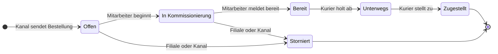
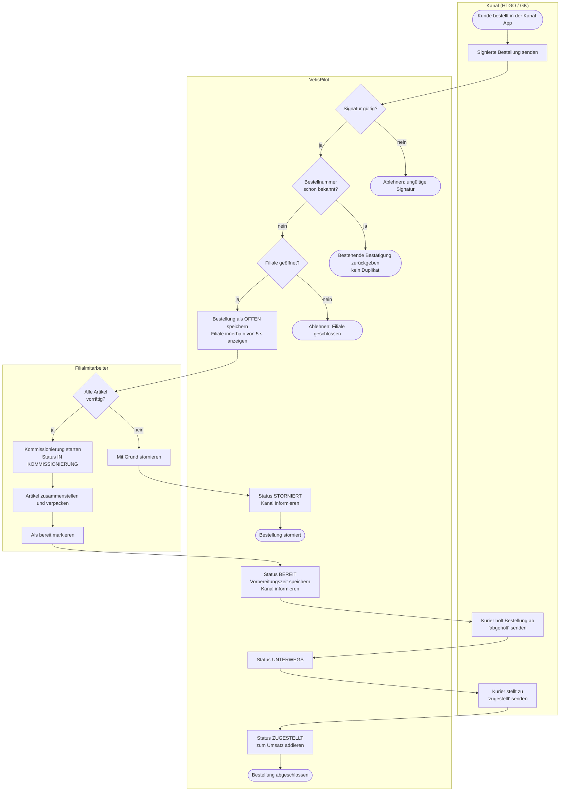
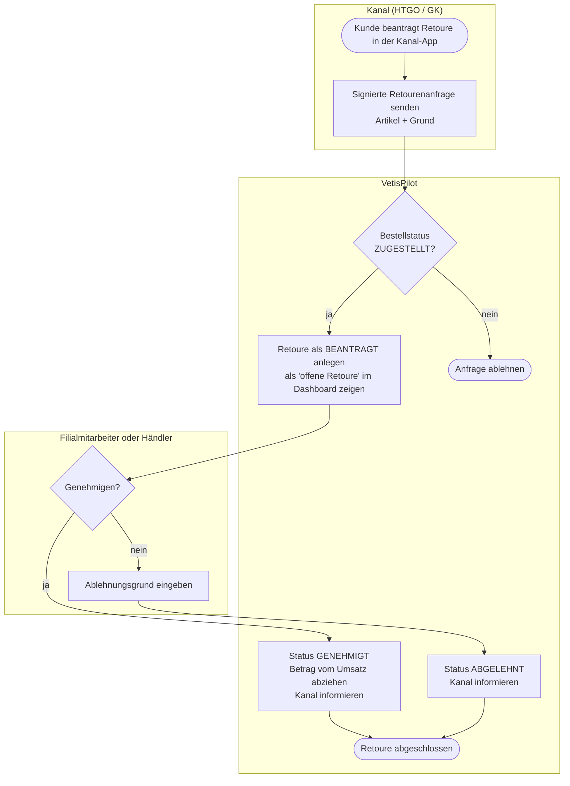
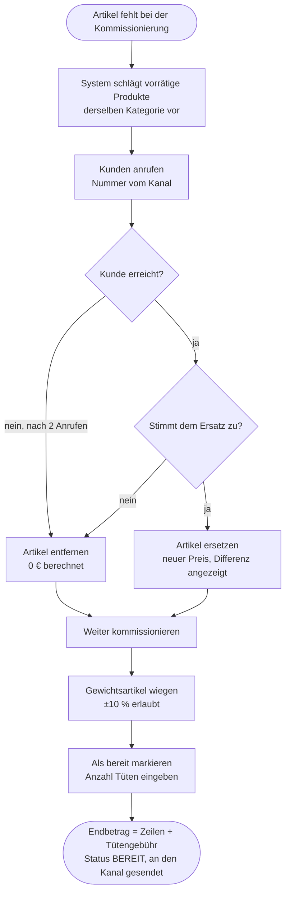
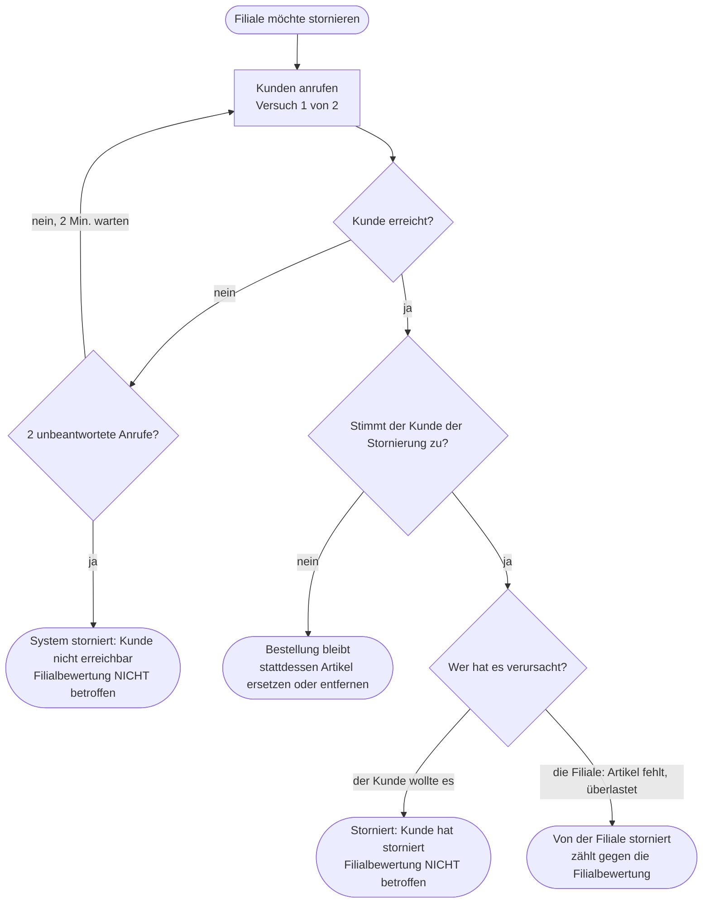

# 04 – Bestellprozess

🇬🇧 [English](04-order-process.md) · 🇩🇪 **Deutsch** · 🇹🇷 [Türkçe](04-order-process.tr.md)

Dieses Dokument beschreibt im BPMN-Stil, wie eine Bestellung vom Kanal zum Kunden gelangt: wer was tut (Bahnen), in welcher Reihenfolge und was passiert, wenn etwas schiefgeht. Zugehörige Stories: US-05 bis US-12, US-18, US-19 in [03 – User Stories](03-user-stories.de.md).

## 1. Bestellstatus
| Status | Technischer Code | Bedeutung | Gesetzt von |
|---|---|---|---|
| Offen | `PENDING` | Bestellung eingegangen, noch niemand bearbeitet sie | VetisPilot (bei Eingang) |
| In Kommissionierung | `PICKING` | Ein Mitarbeiter stellt die Artikel zusammen | Filialmitarbeiter |
| Bereit | `READY` | Verpackt, wartet auf den Kurier | Filialmitarbeiter |
| Unterwegs | `ON_THE_WAY` | Kurier hat abgeholt | Kanal |
| Zugestellt | `DELIVERED` | Kunde hat sie erhalten; zählt zum Umsatz | Kanal |
| Storniert | `CANCELLED` | Wird nicht geliefert; Endzustand | Filialmitarbeiter oder Kanal |

Die technischen Codes bleiben in Datenbank und API auf Englisch; der Bildschirm zeigt den übersetzten Namen.

## 2. Statusdiagramm

## 3. Erlaubte Statuswechsel
Jeder hier nicht aufgeführte Wechsel wird abgelehnt und im Audit-Log gespeichert (US-11).

| Von | Nach | Wer | Bedingung / Regel |
|---|---|---|---|
| – | Offen | Kanal | Gültige HMAC-Signatur, Filiale geöffnet, Bestellnummer noch unbekannt |
| Offen | In Kommissionierung | Filialmitarbeiter | – |
| In Kommissionierung | Bereit | Filialmitarbeiter | Vorbereitungszeit *Offen → Bereit* wird gespeichert |
| Bereit | Unterwegs | Kanal | Kurier hat die Bestellung abgeholt |
| Unterwegs | Zugestellt | Kanal | Bestellung zählt ab jetzt zum Umsatz |
| Offen / In Kommissionierung | Storniert | Filialmitarbeiter | Grund erforderlich **und** Kunde kontaktiert: erreicht und zugestimmt oder 2 unbeantwortete Anrufe (Abschnitt 9, Regel R6) |
| Offen / In Kommissionierung | Storniert | Kanal | Kunde hat storniert; Filiale erhält eine Benachrichtigung |
| Bereit oder später | Storniert | – | **Nicht erlaubt** (Regel A5) |

## 4. Hauptprozess (Normalfall und Entscheidungen)
Bahnen: **Kanal** (HTGO / GK, externes System), **VetisPilot** (unser System), **Filialmitarbeiter** (Person).

## 5. Ausnahmen
| # | Situation | Was passiert | Story |
|---|---|---|---|
| E1 | Signatur fehlt oder ist falsch | Bestellung abgelehnt, nichts gespeichert, Versuch protokolliert | US-05 |
| E2 | Dieselbe Bestellung wird zweimal gesendet (z. B. Netzwerk-Wiederholung) | Zweite Kopie wird ignoriert, Kanal erhält erneut die erste Bestätigung (*Idempotenz*) | US-05 |
| E3 | Filiale ist geschlossen | Bestellung abgelehnt, Kanal informiert | US-21 |
| E4 | Ein Artikel ist in dieser Filiale nicht vorrätig | Bestellung gespeichert, Artikel hervorgehoben; Mitarbeiter entscheidet: stornieren (Grund „Artikel fehlt“) oder den Rest kommissionieren | US-05, US-12 |
| E5 | Bestellung bleibt länger als 3 Minuten *Offen* | In der Liste rot hervorgehoben | US-06 |
| E6 | Kunde storniert in der Kanal-App vor *Bereit* | Status *Storniert*, Filiale erhält eine Benachrichtigung und stoppt die Kommissionierung | US-12 |
| E7 | Kunde storniert nach *Bereit* | In VetisPilot nicht möglich; wird nach der Zustellung als Retoure behandelt | US-12, US-18 |
| E8 | Kanal sendet einen unpassenden Status (z. B. *Zugestellt* für eine *offene* Bestellung) | Abgelehnt und protokolliert, Status bleibt unverändert | US-11 |

## 6. Retourenprozess
Eine Retoure ist nur für eine *zugestellte* Bestellung möglich (A6).

| Retourenstatus | Technischer Code | Gesetzt von |
|---|---|---|
| Beantragt | `REQUESTED` | VetisPilot (bei Eingang) |
| Genehmigt | `APPROVED` | Filialmitarbeiter oder Händler |
| Abgelehnt | `REJECTED` | Filialmitarbeiter oder Händler (Grund erforderlich) |

## 7. Gemessene Zeiten (für Ziel G2)
| Zeit | Von → Nach | Verwendet in |
|---|---|---|
| Reaktionszeit | *Offen* → *In Kommissionierung* | Dashboard, rote Markierung nach 3 Minuten |
| Vorbereitungszeit | *Offen* → *Bereit* | Dashboard, Berichte pro Filiale |
| Lieferzeit | *Bereit* → *Zugestellt* | Berichte pro Kanal (Verantwortung des Kanals) |

## 8. Kommissionierregeln und Endbetrag
Solange eine Bestellung *In Kommissionierung* ist, können drei Dinge den Betrag ändern, den der Kunde zahlt. VetisPilot berechnet den **Endbetrag** und sendet ihn zusammen mit dem Status *Bereit* an den Kanal; der Kanal belastet den Kunden (Zahlungen bleiben außerhalb des Umfangs). Der bestellte Betrag bleibt gespeichert, damit beide Beträge in Berichten verglichen werden können.

| Regel | Was passiert | Beispiel | Story |
|---|---|---|---|
| P0 Mengen | Jede Zeile wird gezählt (kommissioniert / bestellt). Eine fehlende Menge wird wie ein fehlender Artikel behandelt. Die Bestellung kann erst *Bereit* sein, wenn jede Zeile geklärt ist. | Cola 1 L: 3 bestellt, 2 gefunden → Kunde stimmt zu, die 3. zu entfernen: 2 × 1,89 € = **3,78 €** (−1,89 €) | US-34, A12 |
| P1 Ersatz | Fehlender Artikel → Kunde wird angerufen. Zugestimmt: Der Ersatz wird zu seinem eigenen Preis berechnet. Abgelehnt oder nach 2 Anrufen nicht erreicht: Der Artikel wird entfernt und mit 0 € berechnet. | Fettarme Milch 1,19 € → Vollmilch 1,29 €: **+0,10 €** | US-31, A8 |
| P2 Gewicht | Kilopreis × tatsächliches Gewicht. Erlaubt: ±10 % des bestellten Gewichts; außerhalb neu wiegen oder den Kunden fragen. | Bananen, 1 kg bestellt, 1,10 kg kommissioniert: 1,10 × 1,69 € = **1,86 €** | US-32, A9 |
| P3 Tüten | Anzahl Tüten × Tütengebühr der Filiale | 2 Tüten × 0,25 € = **0,50 €** | US-33, A10 |

Jeder Zeilenbetrag wird auf den Cent gerundet (kaufmännisch). **Endbetrag = Summe aller endgültigen Zeilenbeträge + Tütengebühr.**

### Rechenbeispiel
| Zeile | Bestellt | Kommissioniert | Bestellter Betrag | Endbetrag |
|---|---|---|---|---|
| Milvara Fettarme Milch 1,5 % · 1 L | 1 | ersetzt durch Milvara Vollmilch 3,5 % · 1 L (Kunde hat zugestimmt) | 1,19 € | 1,29 € |
| Greenfold Farms Bananen | 1 kg | 1,10 kg | 1,69 € | 1,86 € |
| Crumbwell Buttercroissants · 4 Stk. | 1 | 1 | 2,49 € | 2,49 € |
| Tüten | – | 2 × 0,25 € | – | 0,50 € |
| **Summe** | | | **5,37 €** | **6,14 €** |

### Kommissionierablauf mit Ersatz

### Weitere Ausnahmen
| # | Situation | Was passiert | Story |
|---|---|---|---|
| E9 | Kunde ist wegen eines fehlenden Artikels nach 2 Anrufen nicht erreichbar | Artikel entfernt und nicht berechnet; im Verlauf vermerkt | US-31 |
| E10 | Gewicht außerhalb von ±10 % | Neu wiegen; liegt es weiter außerhalb, muss der Kunde zustimmen, sonst ein anderes Stück nehmen | US-32 |
| E11 | Alle Artikel einer Bestellung wurden entfernt | Die Bestellung wird mit dem Grund *Artikel fehlt* storniert | US-12, US-31 |
| E12 | Das gescannte Produkt ist nicht in der Bestellung | Fehlerton + rote Meldung, nichts gezählt; als Fehlscan gespeichert | US-37 |
| E13 | Ein Barcode ist nicht lesbar (beschädigt) | Mit + von Hand zählen; als manuelle Zählung gespeichert und im Bericht zur Kommissionierqualität gezeigt | US-37, US-38 |
| E14 | Mehr Stück gescannt als bestellt | Hinweis „bereits vollständig“, nichts gezählt | US-37 |

## 9. Stornierung durch die Filiale und Filialbewertung
Die Filiale kann eine Bestellung nicht eigenmächtig stornieren (A11, Regel R6). Jede Stornierung durch die Filiale braucht protokollierte Anrufe (US-35), und die Datenbank prüft das selbst mit einem Trigger.

| Wer / warum | Erlaubt, wenn | Filialbewertung |
|---|---|---|
| Kanal – der Kunde hat in der App storniert | Vor *Bereit* | Nicht betroffen |
| Filiale – Kunde nicht erreichbar | 2 unbeantwortete Anrufe sind protokolliert | Nicht betroffen |
| Filiale – der Kunde wollte am Telefon stornieren | Ein protokollierter Anruf, in dem der Kunde zugestimmt hat | Nicht betroffen |
| Filiale – Artikel fehlt, Filiale überlastet, Sonstiges | Ein protokollierter Anruf, in dem der Kunde zugestimmt hat | **Zählt** |

**Filialbewertung** = von der Filiale verursachte Stornierungen ÷ alle Bestellungen der letzten 30 Tage, pro Filiale und Kanal; Ziel ≤ 2 % (G5, US-36).
