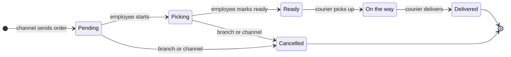
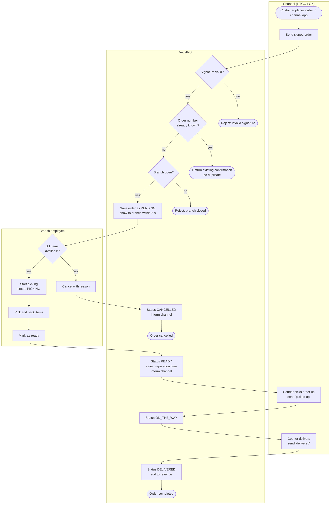
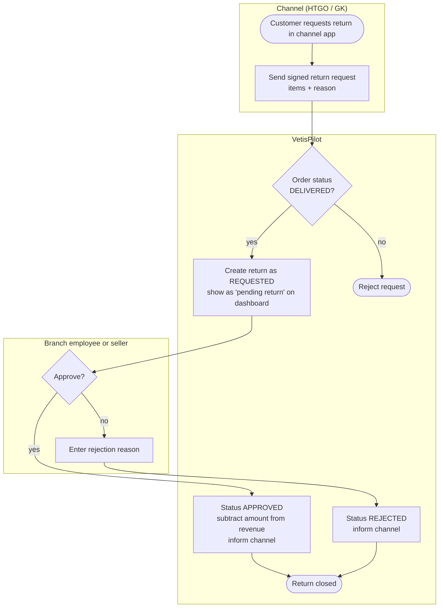
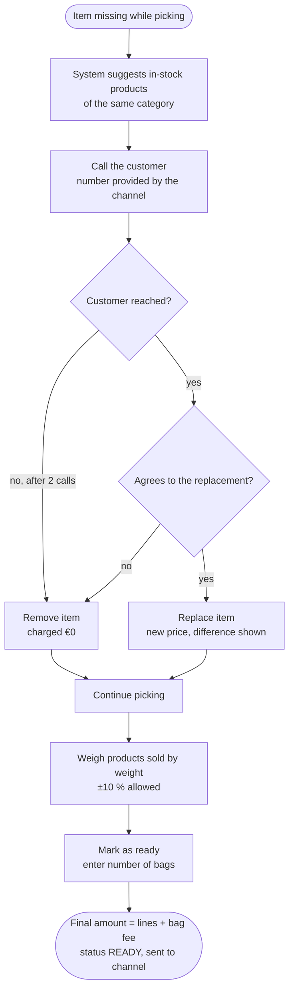
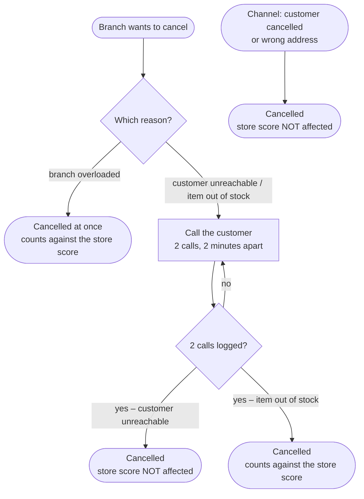

# 04 – Order Process

🇬🇧 **English** · 🇩🇪 [Deutsch](04-order-process.de.md) · 🇹🇷 [Türkçe](04-order-process.tr.md)

This document describes how an order moves from the channel to the customer, in BPMN style: who does what (lanes), in which order, and what happens when something goes wrong. Related stories: US-05 to US-12, US-18, US-19 in [03 – User Stories](03-user-stories.md).

## 1. Order statuses
| Status | Technical code | Meaning | Set by |
|---|---|---|---|
| Pending | `PENDING` | Order received, nobody is working on it yet | VetisPilot (on receipt) |
| Picking | `PICKING` | An employee is picking the items | Branch employee |
| Ready | `READY` | Packed, waiting for the courier | Branch employee |
| On the way | `ON_THE_WAY` | Courier picked it up | Channel |
| Delivered | `DELIVERED` | Customer received it; counts as revenue | Channel |
| Cancelled | `CANCELLED` | Will not be delivered; end state | Branch employee or channel |

Technical codes stay in English in the database and API; the screen shows the translated name.

## 2. Status diagram

## 3. Allowed status changes
Every change not listed here is rejected and written to the audit log (US-11).

| From | To | Who | Condition / rule |
|---|---|---|---|
| – | Pending | Channel | Valid HMAC signature, branch open, order number not yet known |
| Pending | Picking | Branch employee | – |
| Picking | Ready | Branch employee | Preparation time *Pending → Ready* is saved |
| Ready | On the way | Channel | Courier picked the order up |
| On the way | Delivered | Channel | Order counts as revenue from now on |
| Pending / Picking | Cancelled | Branch employee | Reason required **and** the customer was contacted: reached and agreed, or 2 unanswered calls (section 9, rule R6) |
| Pending / Picking | Cancelled | Channel | Customer cancelled; branch gets a notification |
| Ready or later | Cancelled | – | **Not allowed** (rule A5) |

## 4. Main process (happy path and decisions)
Lanes: **Channel** (HTGO / GK, external system), **VetisPilot** (our system), **Branch employee** (person).

## 5. Exceptions
| # | Situation | What happens | Story |
|---|---|---|---|
| E1 | Signature missing or wrong | Order rejected, nothing saved, attempt logged | US-05 |
| E2 | Same order sent twice (e.g. network retry) | Second copy ignored, channel gets the first confirmation again (*idempotency*) | US-05 |
| E3 | Branch is closed | Order rejected, channel informed | US-21 |
| E4 | An item is out of stock in this branch | Order saved, item highlighted; employee decides: cancel (reason "item missing") or pick the rest | US-05, US-12 |
| E5 | Order stays *Pending* longer than 3 minutes | Highlighted in red in the list | US-06 |
| E6 | Customer cancels in the channel app before *Ready* | Status *Cancelled*, branch gets a notification and stops picking | US-12 |
| E7 | Customer cancels after *Ready* | Not possible in VetisPilot; handled as a return after delivery | US-12, US-18 |
| E8 | Channel sends a status that does not fit (e.g. *Delivered* for a *Pending* order) | Rejected and logged, status unchanged | US-11 |

## 6. Return process
A return is only possible for a *Delivered* order (A6).

| Return status | Technical code | Set by |
|---|---|---|
| Requested | `REQUESTED` | VetisPilot (on receipt) |
| Approved | `APPROVED` | Branch employee or seller |
| Rejected | `REJECTED` | Branch employee or seller (reason required) |

## 7. Measured times (for goal G2)
| Time | From → To | Used in |
|---|---|---|
| Reaction time | *Pending* → *Picking* | Dashboard, red highlight after 3 minutes |
| Preparation time | *Pending* → *Ready* | Dashboard, reports per branch |
| Delivery time | *Ready* → *Delivered* | Reports per channel (channel's responsibility) |

## 8. Picking rules and final amount
While an order is *Picking*, three things can change the amount the customer pays. VetisPilot calculates the **final amount** and sends it to the channel together with the status *Ready*; the channel charges the customer (payments stay out of scope). The ordered amount is kept, so both amounts can be compared in reports.

| Rule | What happens | Example | Story |
|---|---|---|---|
| P0 Quantities | Every line is counted (picked / ordered). A missing part is handled like a missing item. The order can only be *Ready* when every line is resolved. | Cola 1 L: 3 ordered, 2 found → customer agrees to remove the 3rd: 2 × €1.89 = **€3.78** (−€1.89) | US-34, A12 |
| P1 Replacement | Missing item → call the customer. Agreed: the replacement is charged at its own price. Declined, or not reached after 2 calls: the item is removed and charged €0. | Semi-Skimmed Milk €1.19 → Whole Milk €1.29: **+€0.10** | US-31, A8 |
| P2 Weight | Price per kg × actual weight. Allowed: ±10 % of the ordered weight; outside, re-weigh or ask the customer. | Bananas, 1 kg ordered, 1.10 kg picked: 1.10 × €1.69 = **€1.86** | US-32, A9 |
| P3 Bags | Number of bags × bag fee of the branch | 2 bags × €0.25 = **€0.50** | US-33, A10 |

Each line amount is rounded to the cent (half up). **Final amount = sum of all final line amounts + bag fee.**

### Worked example
| Line | Ordered | Picked | Ordered amount | Final amount |
|---|---|---|---|---|
| Milvara Semi-Skimmed Milk 1.5 % · 1 L | 1 | replaced by Milvara Whole Milk 3.5 % · 1 L (customer agreed) | €1.19 | €1.29 |
| Greenfold Farms Bananas | 1 kg | 1.10 kg | €1.69 | €1.86 |
| Crumbwell Butter Croissants · 4 pcs | 1 | 1 | €2.49 | €2.49 |
| Bags | – | 2 × €0.25 | – | €0.50 |
| **Total** | | | **€5.37** | **€6.14** |

### Picking flow with replacement

### Additional exceptions
| # | Situation | What happens | Story |
|---|---|---|---|
| E9 | Customer cannot be reached about a missing item after 2 calls | Item removed and not charged; noted in the history | US-31 |
| E10 | Weight outside ±10 % | Re-weigh; if still outside, the customer must agree, otherwise take a different piece | US-32 |
| E11 | Every item of an order was removed | The order is cancelled with reason *item missing* | US-12, US-31 |
| E12 | The scanned product is not in the order | Error sound + red message, nothing counted; saved as a wrong scan | US-37 |
| E13 | A barcode cannot be read (damaged) | Count by hand with +; saved as a manual count and shown in the picking quality report | US-37, US-38 |
| E14 | More pieces scanned than ordered | Warning "already complete", nothing counted | US-37 |

## 9. Cancellation by the branch and store score
*Updated after the prototype test (v1.0.1) – see [06 – Prototype decisions §4](06-prototype-decisions.md).* The branch must choose a reason first; nothing is pre-selected. The database checks the rule itself with a trigger (rule R6).

| Who / why | Allowed when | Store score |
|---|---|---|
| Channel – customer cancelled in the app, wrong address | Before *Ready* | Not affected |
| Branch – branch overloaded | At once, no call needed | **Counts** |
| Branch – customer unreachable | 2 logged calls | Not affected |
| Branch – item out of stock | 2 logged calls | **Counts** |

**Store score** = store-caused cancellations ÷ all orders of the last 30 days, per branch and channel; target ≤ 2 % (G5, US-36).

## 10. Amount protection when picking
Before an order can be *Ready*, the panel checks the amounts (US-44, US-45; details in [06 §2](06-prototype-decisions.md)):
- every weighed line within **±10 %** of the ordered weight;
- products at most **+15 %** of the ordered value – a hard limit, also with the customer's approval;
- missing products or a drop of more than **15 %** only after at least **1 logged call** to the customer and the tick *"customer informed and agreed"*.

## 11. Courier capacity and split orders
One courier carries at most **20 litres**. An order above 20 L is split automatically into as few parts as possible, the litres shared evenly and every product kept in one part (US-46; details in [06 §3](06-prototype-decisions.md)). Each part follows this process on its own (accept, pick, ready); reports count it as one order.
