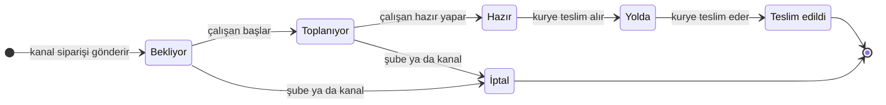
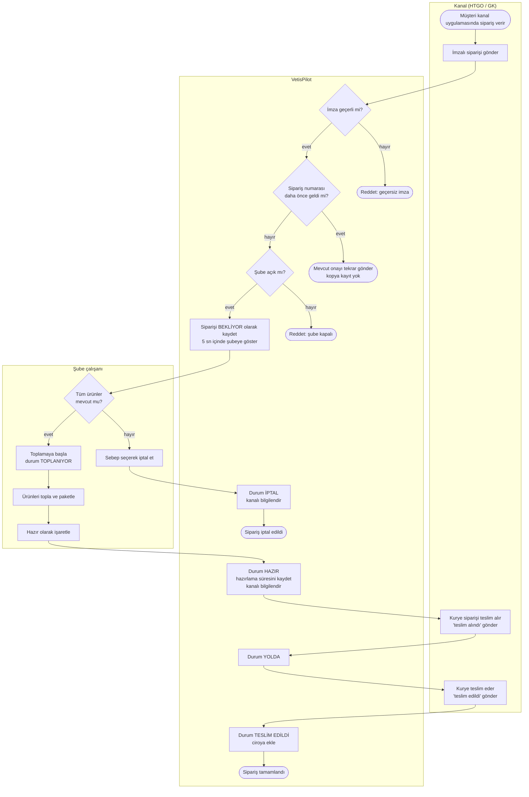
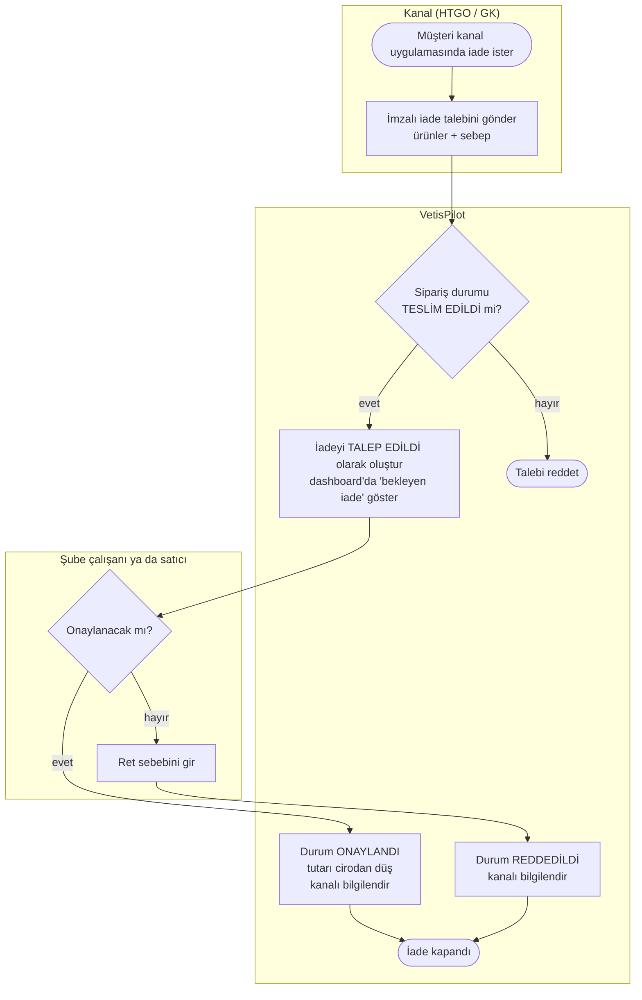
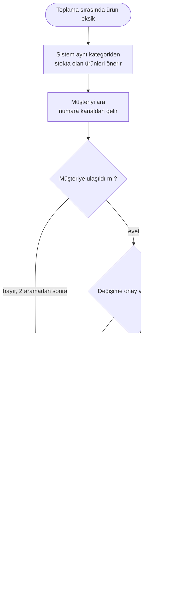
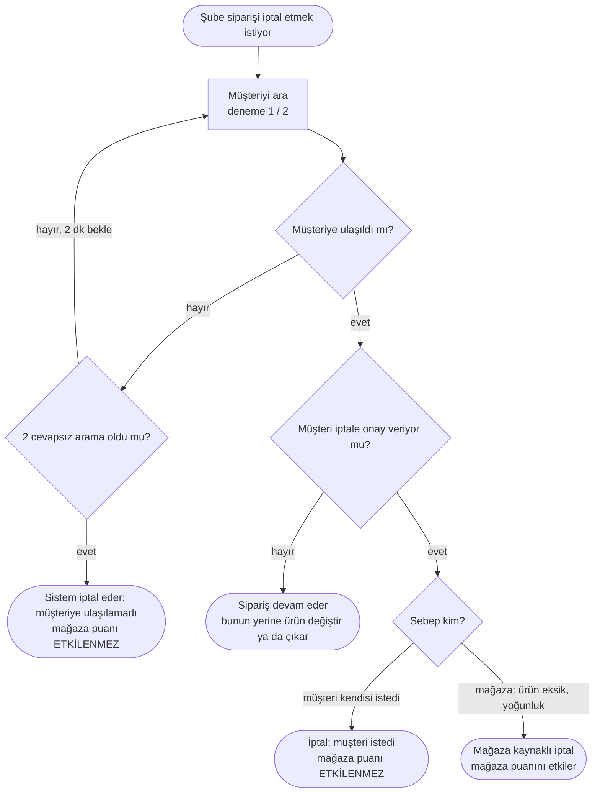

# 04 – Sipariş Süreci

🇬🇧 [English](04-order-process.md) · 🇩🇪 [Deutsch](04-order-process.de.md) · 🇹🇷 **Türkçe**

Bu belge, bir siparişin kanaldan müşteriye nasıl ilerlediğini BPMN mantığıyla anlatır: kim ne yapar (kulvarlar), hangi sırayla ve bir şey ters gidince ne olur. İlgili story'ler: [03 – User Story'ler](03-user-stories.tr.md) belgesindeki US-05 – US-12, US-18, US-19.

## 1. Sipariş durumları
| Durum | Teknik kod | Anlamı | Kim belirler |
|---|---|---|---|
| Bekliyor | `PENDING` | Sipariş geldi, henüz kimse ilgilenmiyor | VetisPilot (geldiği anda) |
| Toplanıyor | `PICKING` | Bir çalışan ürünleri topluyor | Şube çalışanı |
| Hazır | `READY` | Paketlendi, kuryeyi bekliyor | Şube çalışanı |
| Yolda | `ON_THE_WAY` | Kurye teslim aldı | Kanal |
| Teslim edildi | `DELIVERED` | Müşteri teslim aldı; ciroya sayılır | Kanal |
| İptal | `CANCELLED` | Teslim edilmeyecek; son durum | Şube çalışanı ya da kanal |

Teknik kodlar veritabanında ve API'de İngilizce kalır; ekranda çevrilmiş adı görünür.

## 2. Durum diyagramı

## 3. İzin verilen durum geçişleri
Burada olmayan her geçiş reddedilir ve audit log'a yazılır (US-11).

| Nereden | Nereye | Kim | Koşul / kural |
|---|---|---|---|
| – | Bekliyor | Kanal | Geçerli HMAC imzası, şube açık, sipariş numarası daha önce gelmemiş |
| Bekliyor | Toplanıyor | Şube çalışanı | – |
| Toplanıyor | Hazır | Şube çalışanı | *Bekliyor → Hazır* hazırlama süresi kaydedilir |
| Hazır | Yolda | Kanal | Kurye siparişi teslim aldı |
| Yolda | Teslim edildi | Kanal | Sipariş bundan sonra ciroya sayılır |
| Bekliyor / Toplanıyor | İptal | Şube çalışanı | Sebep zorunlu **ve** müşteriyle iletişim kuruldu: ulaşıldı ve onay verdi ya da 2 cevapsız arama (bölüm 9, kural R6) |
| Bekliyor / Toplanıyor | İptal | Kanal | Müşteri iptal etti; şube bildirim alır |
| Hazır ya da sonrası | İptal | – | **İzin verilmez** (kural A5) |

## 4. Ana süreç (normal akış ve kararlar)
Kulvarlar: **Kanal** (HTGO / GK, dış sistem), **VetisPilot** (bizim sistemimiz), **Şube çalışanı** (kişi).

## 5. İstisnalar
| # | Durum | Ne olur | Story |
|---|---|---|---|
| E1 | İmza yok ya da hatalı | Sipariş reddedilir, hiçbir şey kaydedilmez, deneme kayda geçer | US-05 |
| E2 | Aynı sipariş iki kez gelir (ör. ağ hatası sonrası tekrar gönderim) | İkinci kopya yok sayılır, kanal ilk onayı tekrar alır (*idempotency*) | US-05 |
| E3 | Şube kapalı | Sipariş reddedilir, kanal bilgilendirilir | US-21 |
| E4 | Bir ürün bu şubede stokta yok | Sipariş kaydedilir, ürün vurgulanır; çalışan karar verir: iptal (sebep "ürün eksik") ya da kalanları topla | US-05, US-12 |
| E5 | Sipariş 3 dakikadan uzun *Bekliyor* durumunda kalır | Listede kırmızıyla vurgulanır | US-06 |
| E6 | Müşteri *Hazır*'dan önce kanal uygulamasında iptal eder | Durum *İptal*, şube bildirim alır ve toplamayı bırakır | US-12 |
| E7 | Müşteri *Hazır*'dan sonra iptal etmek ister | VetisPilot'ta mümkün değil; teslimattan sonra iade olarak işlenir | US-12, US-18 |
| E8 | Kanal uymayan bir durum gönderir (ör. *Bekliyor* durumundaki bir sipariş için *Teslim edildi*) | Reddedilir ve kayda geçer, durum değişmez | US-11 |

## 6. İade süreci
İade sadece *Teslim edildi* durumundaki bir sipariş için mümkündür (A6).

| İade durumu | Teknik kod | Kim belirler |
|---|---|---|
| Talep edildi | `REQUESTED` | VetisPilot (geldiği anda) |
| Onaylandı | `APPROVED` | Şube çalışanı ya da satıcı |
| Reddedildi | `REJECTED` | Şube çalışanı ya da satıcı (sebep zorunlu) |

## 7. Ölçülen süreler (G2 hedefi için)
| Süre | Nereden → Nereye | Nerede kullanılır |
|---|---|---|
| Tepki süresi | *Bekliyor* → *Toplanıyor* | Dashboard, 3 dakikadan sonra kırmızı vurgu |
| Hazırlama süresi | *Bekliyor* → *Hazır* | Dashboard, şube bazında raporlar |
| Teslimat süresi | *Hazır* → *Teslim edildi* | Kanal bazında raporlar (kanalın sorumluluğu) |

## 8. Toplama kuralları ve son tutar
Bir sipariş *Toplanıyor* durumundayken üç şey müşterinin ödeyeceği tutarı değiştirebilir. VetisPilot **son tutarı** hesaplar ve *Hazır* durumuyla birlikte kanala gönderir; ödemeyi müşteriden kanal alır (ödemeler kapsam dışında kalır). Sipariş edilen tutar da saklanır, böylece iki tutar raporlarda karşılaştırılabilir.

| Kural | Ne olur | Örnek | Story |
|---|---|---|---|
| P0 Adetler | Her satır sayılır (toplanan / sipariş edilen). Eksik kalan adet, eksik ürün gibi işlenir. Sipariş ancak tüm satırlar netleşince *Hazır* olabilir. | Kola 1 L: 3 sipariş, 2 bulundu → müşteri 3.'nün çıkarılmasına onay verir: 2 × €1,89 = **€3,78** (−€1,89) | US-34, A12 |
| P1 Ürün değişimi | Eksik ürün → müşteri aranır. Onay verdi: yeni ürün kendi fiyatıyla ücretlendirilir. Kabul etmedi ya da 2 aramada ulaşılamadı: ürün çıkarılır ve €0 ücretlendirilir. | Yarım Yağlı Süt €1,19 → Tam Yağlı Süt €1,29: **+€0,10** | US-31, A8 |
| P2 Ağırlık | Kilo fiyatı × gerçek ağırlık. İzin verilen: sipariş edilen ağırlığın ±%10'u; dışındaysa yeniden tart ya da müşteriye sor. | Muz, 1 kg sipariş, 1,10 kg toplandı: 1,10 × €1,69 = **€1,86** | US-32, A9 |
| P3 Poşet | Poşet sayısı × şubenin poşet ücreti | 2 poşet × €0,25 = **€0,50** | US-33, A10 |

Her satır tutarı kuruşa yuvarlanır (yarım ve üstü yukarı). **Son tutar = tüm son satır tutarlarının toplamı + poşet ücreti.**

### Hesap örneği
| Satır | Sipariş edilen | Toplanan | Sipariş tutarı | Son tutar |
|---|---|---|---|---|
| Milvara Yarım Yağlı Süt %1,5 · 1 L | 1 | Milvara Tam Yağlı Süt %3,5 · 1 L ile değiştirildi (müşteri onayladı) | €1,19 | €1,29 |
| Greenfold Farms Muz | 1 kg | 1,10 kg | €1,69 | €1,86 |
| Crumbwell Tereyağlı Kruvasan · 4 adet | 1 | 1 | €2,49 | €2,49 |
| Poşet | – | 2 × €0,25 | – | €0,50 |
| **Toplam** | | | **€5,37** | **€6,14** |

### Ürün değişimli toplama akışı

### Ek istisnalar
| # | Durum | Ne olur | Story |
|---|---|---|---|
| E9 | Eksik ürün için 2 aramada müşteriye ulaşılamıyor | Ürün çıkarılır ve ücretlendirilmez; geçmişe not düşülür | US-31 |
| E10 | Ağırlık ±%10'un dışında | Yeniden tartılır; hâlâ dışındaysa müşterinin onayı gerekir, yoksa başka bir parça alınır | US-32 |
| E11 | Siparişteki tüm ürünler çıkarıldı | Sipariş *ürün eksik* sebebiyle iptal edilir | US-12, US-31 |
| E12 | Okutulan ürün siparişte yok | Hata sesi + kırmızı mesaj, hiçbir şey sayılmaz; yanlış okutma olarak kaydedilir | US-37 |
| E13 | Barkod okunmuyor (bozuk) | + ile elle sayılır; manuel sayım olarak kaydedilir ve toplama kalitesi raporunda görünür | US-37, US-38 |
| E14 | Sipariş edilenden fazla okutuldu | "zaten tamamlandı" uyarısı, hiçbir şey sayılmaz | US-37 |

## 9. Şube tarafından iptal ve mağaza puanı
Şube bir siparişi kendi başına iptal edemez (A11, kural R6). Şubenin yaptığı her iptal kayıtlı aramalara dayanmalıdır (US-35); bunu veritabanı bir trigger ile kendisi kontrol eder.

| Kim / neden | Ne zaman izinli | Mağaza puanı |
|---|---|---|
| Kanal – müşteri uygulamada iptal etti | *Hazır*'dan önce | Etkilenmez |
| Şube – müşteriye ulaşılamadı | 2 cevapsız arama kayıtlı | Etkilenmez |
| Şube – müşteri telefonda iptal istedi | Müşterinin onay verdiği kayıtlı bir arama | Etkilenmez |
| Şube – ürün eksik, şube yoğun, diğer | Müşterinin onay verdiği kayıtlı bir arama | **Etkiler** |

**Mağaza puanı** = son 30 gündeki mağaza kaynaklı iptaller ÷ tüm siparişler, şube ve kanal bazında; hedef ≤ %2 (G5, US-36).
