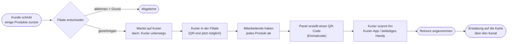

# 06 – Entscheidungen aus dem klickbaren Prototyp

🇬🇧 [English](06-prototype-decisions.md) · 🇩🇪 **Deutsch** · 🇹🇷 [Türkçe](06-prototype-decisions.tr.md)

Mit dem klickbaren Prototyp [prototype/panel.html](../../prototype/panel.html) (Version **v1.0.1**, Beispieldaten) wurden die Bildschirme mit echten Nutzern ausprobiert, bevor das Backend gebaut wird. Dabei sind viele neue Geschäftsregeln entstanden. Dieses Dokument sammelt sie an einer Stelle: **was** entschieden wurde, **warum**, welche User Stories und Bildschirme betroffen sind und was das für die Datenbank bedeutet. Neue Stories sind US-40 – US-53 in [03 – User Stories](03-user-stories.de.md), neue Bildschirme S-19 – S-23 in [05 – Bildschirme](05-screens.de.md).

## 1. Überblick
| ID | Entscheidung | Stories | Bildschirm |
|---|---|---|---|
| PD-01 | Filialname **Lindenkorb Supermarkt · Berlin-Spandau**, Anmeldung mit Demo-Konten (4 Mitarbeitende) | US-01 | S-01 |
| PD-02 | Ein Produkt kann **pro Kanal für den Verkauf freigegeben oder gesperrt** werden | US-40 | S-19 |
| PD-03 | **Hinweis bei neuer Bestellung:** eigener Ton pro Kanal + 3 Sekunden Banner in den Kanalfarben | US-41 | alle |
| PD-04 | **Wartestufen** für nicht angenommene Bestellungen: neu · wartet · verspätet · stark verspätet | US-42 | S-04 |
| PD-05 | **WhatsApp-Erinnerung** alle 2 Minuten, solange Bestellungen warten | US-43 | S-20 |
| PD-06 | **Betragsschutz:** Gewicht ±10 % pro Zeile, Warenwert höchstens +15 % | US-44 | S-05 |
| PD-07 | Fehlende Produkte / starker Rückgang nur mit **protokollierter Zustimmung des Kunden** | US-45 | S-05 |
| PD-08 | **Kurierkapazität 20 Liter;** größere Bestellungen werden automatisch und gleichmäßig geteilt | US-46 | S-04, S-05 |
| PD-09 | **Neue Stornoregeln:** zuerst den Grund wählen; „Filiale überlastet“ ohne Anruf | US-12 | S-05 |
| PD-10 | **Teilretouren:** nur einige Produkte einer Bestellung, mit Foto und Menge | US-47 | S-08 |
| PD-11 | **Retourenübergabe mit QR-Code,** den der Kurier scannt | US-48 | S-21, S-22 |
| PD-12 | **Erstattung** auf die Karte des Kunden, sobald die Retoure angenommen ist | US-49 | S-21 |
| PD-13 | Gründe für Retouren und Stornos sind immer sichtbar und filterbar | US-50 | S-04, S-08 |
| PD-14 | **Kundenbewertungen** in drei Kriterien: Service, Geschmack, Lieferung | US-51 | S-03, S-23 |
| PD-15 | Verkaufsbericht **pro Tag, Woche, Monat, Jahr,** Detaillisten in der Tagesansicht | US-52 | S-12 |
| PD-16 | **Tag- und Nachtmodus** | US-53 | alle |
| PD-17 | **Demo-Tour** in 6 Schritten beim ersten Besuch (auf dem Gerät gespeichert), im Profilmenü erneut startbar | – | alle |

## 2. Betragsschutz (PD-06, PD-07)
**Problem:** Eine Mitarbeiterin tippt 15 kg statt 1 kg Bananen ein – von der Karte des Kunden würde viel zu viel abgebucht.

| Regel | Grenze | Was passiert |
|---|---|---|
| Gewogene Zeile | bestelltes Gewicht **±10 %** (1 kg → 0,90 – 1,10 kg) | Feld wird rot, *Bereit* ist gesperrt |
| Warenwert (ohne Tütengebühr) | höchstens **+15 %** des bestellten Werts | **Feste Grenze** – auch mit Zustimmung des Kunden |
| Warenwert niedriger / Produkte fehlen | mehr als **−15 %** oder eine fehlende Zeile | Nur erlaubt nach mindestens **1 protokollierten Anruf** beim Kunden und dem Haken „Kunde informiert und einverstanden“; die Uhrzeit wird gespeichert |

| Bestellt | Höchstens (+15 %) | Zustimmung nötig unter (−15 %) |
|---|---|---|
| 7,00 € | 8,05 € | 5,95 € |
| 20,00 € | 23,00 € | 17,00 € |
| 100,00 € | 115,00 € | 85,00 € |

**Warum +15 %:** Lieferplattformen reservieren den Bestellwert plus einen Puffer auf der Karte (Vorautorisierung) und buchen den Endbetrag später ab. Unsere Grenze entspricht diesem Puffer, Bank und Panel nutzen also dieselbe Regel.

## 3. Kurierkapazität und geteilte Bestellungen (PD-08)
- Jedes Produkt hat ein **Volumen in Litern** (inklusive Verpackung; sperrige Artikel zählen mehr, z. B. Toilettenpapier 9 L, Chips 1,8 L).
- Ein Kurier trägt höchstens **20 L**. Eine Bestellung über 20 L wird automatisch geteilt:
  1. Anzahl der Teile = Gesamtvolumen ÷ 20, aufgerundet (36,6 L → 2 Teile).
  2. Eine Produktzeile bleibt **ganz in einem Teil** (kein Produkt in zwei Teilen); nur eine Zeile, die allein über 20 L liegt, wird geteilt.
  3. Die Zeilen gehen, die größten zuerst, an den Teil mit der geringsten Last → die Liter werden so gleichmäßig wie möglich verteilt.
- Jeder Teil behält die Bestellnummer mit dem Hinweis *„(automatisch geteilte Bestellung · Teil n)“*, wartet als eigene Zeile, wird separat kommissioniert und von einem eigenen Kurier geliefert. In Zählungen und Berichten ist eine geteilte Bestellung **eine** Bestellung.

| Beispiel | Teil 1 | Teil 2 |
|---|---|---|
| HT-10485 (36,6 L) | 3× Wasser 5 L, 2× Chips → 19,2 L | Toilettenpapier, 4× Cola, 4× Milch → 17,4 L |
| GK-55124 (32,3 L) | 2× Wasser 5 L, 4× Milch, 2× Tomaten → 17,0 L | Toilettenpapier, 6× Orangensaft → 15,3 L |

## 4. Stornierung durch die Filiale (PD-09)
Ersetzt die Tabelle in [04 – Bestellprozess §9](04-order-process.de.md).

| Grund (von der Filiale gewählt) | Erlaubt, wenn | Filialbewertung |
|---|---|---|
| Filiale überlastet | sofort, **kein Anruf nötig** | **Zählt** |
| Kunde nicht erreichbar | nach **2 protokollierten Anrufen** (2 Minuten Abstand) | Nicht betroffen |
| Artikel nicht vorrätig | nach **2 protokollierten Anrufen** | **Zählt** |
| Kunde hat storniert / Adresse fehlerhaft | nur vom **Kanal**, der Filiale nicht angeboten | Nicht betroffen |

- Kein Grund ist vorausgewählt; der Button *Stornieren* bleibt grau, bis ein Grund gewählt ist, dann wird er rot.

## 5. Bestellhinweise und WhatsApp-Erinnerungen (PD-03 – PD-05)
| Wartezeit | Stufe | Aktion |
|---|---|---|
| bei Eingang | Neu | Ton (HTGO: Glocke, GK: Marimba) + Banner *„Neue Bestellung · Kanal“* für 3 Sekunden |
| ab 2 Min. | Wartet | WhatsApp: *„… Bestellungen warten seit 2 Minuten“* |
| ab 6 Min. | Verspätet | WhatsApp alle 2 Minuten: *„… Bestellungen sind verspätet“* |
| ab 12 Min. | Stark verspätet | WhatsApp: *„… Bestellungen stark verspätet – bitte sofort annehmen“* |

- Der Server prüft alle 2 Minuten; der Text richtet sich nach der **ältesten** wartenden Bestellung. Empfänger: Mitarbeitende im Dienst mit hinterlegter Telefonnummer und eingeschaltetem WhatsApp.
- In der echten App kommt der Ton als **Push-Benachrichtigung** der mobilen App (auch bei gesperrtem Handy); WhatsApp-Nachrichten laufen über die **WhatsApp Business API** mit einer freigegebenen Vorlage.

## 6. Retouren, QR-Übergabe und Erstattung (PD-10 – PD-13)

- Eine Retoure zeigt nur die zurückgeschickten Produkte mit Foto und Menge; Erstattung = zurückgegebene Menge × Preis der Bestellzeile (US-14).
- Retourengründe: beschädigt, verdorben, Mindesthaltbarkeit abgelaufen, falsches Produkt, fehlendes Produkt, Kühlkette unterbrochen – plus die eigene Notiz des Kunden. Ein Tipp auf den Grund öffnet die Bestellung mit markierten Zeilen; die Grund-Chips filtern die Liste.

## 7. Weitere Entscheidungen
- **Verkauf freigeben / sperren (PD-02):** zwei Schalter pro Produkt (HTGO, GK). Ein gesperrtes Produkt sehen die Kunden dieses Kanals nicht; Bestand 0 sperrt automatisch.
- **Bewertungen (PD-14):** HTGO 4,9 (2304 Bewertungen), GK 4,7 (2026 Bewertungen); jede Bewertung hat 1 – 5 Sterne für Service, Geschmack und Lieferung. Das Panel zeigt sie nur an.
- **Berichte (PD-15):** Die Zahlen von heute werden aus den Bestellzeilen selbst gezählt, deshalb stimmen Startseite, Reiter *Alle* und Tagesbericht immer überein. In der Tagesansicht öffnen die Kästen *Bestellungen, Umsatz, Stornierungen, Retouren* die Liste hinter der Zahl. Sonntags geschlossen (Deutschland).
- **Tag- / Nachtmodus (PD-16):** Sonne-/Mond-Button neben dem Profil; die Wahl wird auf dem Gerät gespeichert.

## 8. Rechtliche Hinweise
- **Marke:** „WhatsApp“ darf genannt werden, um die Anbindung zu beschreiben; das Logo wird nicht verwendet und keine Partnerschaft vorgetäuscht.
- **DSGVO:** Die Telefonnummer von Mitarbeitenden ist ein personenbezogenes Datum – WhatsApp-Erinnerungen brauchen die Einwilligung (Schalter pro Person) und einen Hinweis in der Datenschutzerklärung (Daten gehen an Meta, USA). Nummern werden maskiert angezeigt.
- **Betriebsrat:** „Wer hat wie schnell angenommen“ kann zur Leistungskontrolle dienen, deshalb muss der Betriebsrat zustimmen, bevor solche Daten pro Person ausgewertet werden.
- Erinnerungen gehen nur an Mitarbeitende im Dienst (Arbeitszeitgesetz).

## 9. Auswirkungen auf die Datenbank (für eine spätere Migration geplant)
| Änderung | Grund |
|---|---|
| `products.volume_l` | Kurierkapazität (PD-08) |
| neu `product_channel_status (product_id, channel_id, on_sale)` | Verkauf pro Kanal freigeben / sperren (PD-02) |
| `orders.split_parent_id`, `orders.split_part` | geteilte Bestellungen (PD-08) |
| `orders.customer_ok_at` | Zustimmung bei fehlenden Produkten / starkem Rückgang (PD-07) |
| Trigger `orders_cancel_guard`: *Filiale überlastet* ohne Anruf; *Adresse fehlerhaft* nur vom Kanal | neue Stornoregeln (PD-09) |
| `returns.reason_code` | Retourengründe (PD-13) |
| neu `return_handovers (return_id, token, status, qr_created_at, received_at, courier)` und Erstattungszeit | QR-Übergabe und Erstattung (PD-11, PD-12) |
| `users.phone`, `users.whatsapp_opt_in` + neu `notification_log` | WhatsApp-Erinnerungen und Einwilligung (PD-05) |
| neu `reviews (order_id, service, taste, delivery, comment)` | Bewertungen (PD-14) |

## 10. Offene Fragen
- Soll die 20-L-Grenze vom Fahrzeug des Kuriers abhängen (Fahrrad oder Auto)?
- Ist „Geschmack“ das richtige Kriterium für einen Supermarkt oder eher „Produktqualität“?
- Wer darf ein Produkt sperren: alle Mitarbeitenden oder nur die Filialleitung?
