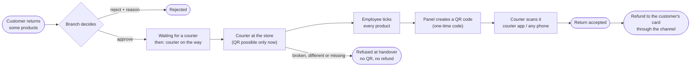

# 06 – Decisions from the Clickable Prototype

🇬🇧 **English** · 🇩🇪 [Deutsch](06-prototype-decisions.de.md) · 🇹🇷 [Türkçe](06-prototype-decisions.tr.md)

The clickable prototype [prototype/panel.html](../../prototype/panel.html) (version **v1.0.1**, sample data) was used to try the screens with real users before the backend is built. While testing it, many new business rules came up. This document collects them in one place: **what** was decided, **why**, which user stories and screens it touches, and what it means for the database. New stories are US-40 – US-54 in [03 – User Stories](03-user-stories.md), new screens S-19 – S-24 in [05 – Screens](05-screens.md).

## 1. Overview
| ID | Decision | Stories | Screen |
|---|---|---|---|
| PD-01 | Branch name **Lindenkorb Supermarket · Berlin-Spandau**, login with demo accounts (4 employees) | US-01 | S-01 |
| PD-02 | A product can be **opened or closed for sale per channel** | US-40 | S-19 |
| PD-03 | **New-order alert:** own sound per channel + 3-second banner in the channel's colours | US-41 | all |
| PD-04 | **Waiting levels** for orders not accepted: new · waiting · late · very late | US-42 | S-04 |
| PD-05 | **WhatsApp reminder** every 2 minutes while orders wait | US-43 | S-20 |
| PD-06 | **Amount protection:** weight ±10 % per line, products at most +15 % | US-44 | S-05 |
| PD-07 | Missing products / big drop only with the **customer's logged approval** | US-45 | S-05 |
| PD-08 | **Courier capacity 20 litres;** bigger orders are split automatically and evenly | US-46 | S-04, S-05 |
| PD-09 | **New cancellation rules:** reason first; "branch overloaded" without calls | US-12 | S-05 |
| PD-10 | **Partial returns:** only some products of an order, with photo and quantity | US-47 | S-08 |
| PD-11 | **Return handover with a QR code** scanned by the courier | US-48 | S-21, S-22 |
| PD-12 | **Refund** to the customer's card as soon as the return is accepted | US-49 | S-21 |
| PD-13 | Reasons for returns and cancellations are always visible and can be filtered | US-50 | S-04, S-08 |
| PD-14 | **Customer ratings** in three criteria: service, taste, delivery | US-51 | S-03, S-23 |
| PD-15 | Sales report **per day, week, month, year**, drill-down lists in the daily view | US-52 | S-12 |
| PD-16 | **Day and night mode** | US-53 | all |
| PD-17 | **Demo tour** in 6 steps on the first visit (stored on the device), can be restarted from the profile menu | – | all |
| PD-18 | **Time-limited discounts per channel:** all, category, selected or best-before-soon products; percent or amount; minutes to weeks | US-54 | S-24 |

## 2. Amount protection (PD-06, PD-07)
**Problem:** an employee types 15 kg instead of 1 kg of bananas – the customer's card would be charged far too much.

| Rule | Limit | What happens |
|---|---|---|
| Weighed line | ordered weight **±10 %** (1 kg → 0.90 – 1.10 kg) | Field turns red, *Ready* is blocked |
| Products total (bag fee not included) | at most **+15 %** of the ordered value | **Hard limit** – even with the customer's approval |
| Products total lower / products missing | more than **−15 %** or a missing line | Allowed only after at least **1 logged call** to the customer and the tick *"customer informed and agreed"*; the time is stored |

| Ordered | Maximum (+15 %) | Approval needed below (−15 %) |
|---|---|---|
| 7.00 € | 8.05 € | 5.95 € |
| 20.00 € | 23.00 € | 17.00 € |
| 100.00 € | 115.00 € | 85.00 € |

**Why +15 %:** delivery platforms reserve the order value plus a buffer on the card (pre-authorisation) and capture the final amount later. Our limit matches that buffer, so the bank side and the panel use the same rule.

## 3. Courier capacity and split orders (PD-08)
- Every product has a **volume in litres** (packaging included; bulky items count more, e.g. toilet paper 9 L, chips 1.8 L).
- One courier carries at most **20 L**. An order above 20 L is split automatically:
  1. Number of parts = total ÷ 20, rounded up (36.6 L → 2 parts).
  2. A product line stays **whole in one part** (no product in two parts); only a line that alone is over 20 L is cut.
  3. Lines go biggest first to the part that carries the least → the litres are shared as evenly as possible.
- Each part keeps the order number with the note *"(automatically split order · part n)"*, waits as its own row, is picked separately and goes with its own courier. In counts and reports a split order is **one** order.

| Example | Part 1 | Part 2 |
|---|---|---|
| HT-10485 (36.6 L) | 3× water 5 L, 2× chips → 19.2 L | toilet paper, 4× cola, 4× milk → 17.4 L |
| GK-55124 (32.3 L) | 2× water 5 L, 4× milk, 2× tomatoes → 17.0 L | toilet paper, 6× orange juice → 15.3 L |

## 4. Cancellation by the branch (PD-09)
This replaces the table in [04 – Order Process §9](04-order-process.md).

| Reason (chosen by the branch) | Allowed when | Store score |
|---|---|---|
| Branch overloaded | at once, **no call needed** | **Counts** |
| Customer unreachable | after **2 logged calls** (2 minutes apart) | Not affected |
| Item out of stock | after **2 logged calls** | **Counts** |
| Customer cancelled / wrong address | only from the **channel**, not offered to the branch | Not affected |

- No reason is pre-selected; the *Cancel* button stays grey until a reason is chosen, then turns red.

## 5. Order alerts and WhatsApp reminders (PD-03 – PD-05)
| Waiting time | Label | Action |
|---|---|---|
| on arrival | New | Sound (HTGO: bell, GK: marimba) + banner *"New order · channel"* for 3 seconds |
| from 2 min | Waiting | WhatsApp: *"… orders have been waiting 2 minutes"* |
| from 6 min | Late | WhatsApp every 2 minutes: *"… orders are late"* |
| from 12 min | Very late | WhatsApp: *"… orders are very late – please accept now"* |

- The server checks every 2 minutes; the text depends on the **oldest** waiting order. Recipients: staff on shift with a registered phone number and WhatsApp switched on.
- In the real app the sound comes as a **push notification** of the mobile app (also on a locked phone); WhatsApp messages go through the **WhatsApp Business API** with an approved template.

## 6. Returns, QR handover and refund (PD-10 – PD-13)

- A return lists only the returned products with photo and quantity; refund = returned quantity × price on the order line (US-14).
- Return reasons: damaged, spoiled, past best-before date, wrong product, missing product, cold chain broken – plus the customer's own note. Tapping a reason opens the order with the returned lines marked; reason chips filter the list.

## 7. Other decisions
- **Sale open / close (PD-02):** two switches per product (HTGO, GK). A closed product is hidden from that channel's customers; stock 0 closes it automatically.
- **Ratings (PD-14):** HTGO 4.9 (2304 reviews), GK 4.7 (2026 reviews); every review has 1 – 5 stars for service, taste and delivery. The panel only shows them.
- **Reports (PD-15):** today's numbers are counted from the order rows themselves, so the home page, the *All* tab and the daily report always match. In the daily view the boxes *Orders, Revenue, Cancellations, Returns* open the list behind the number. Sundays are closed (Germany).
- **Day / night mode (PD-16):** sun / moon button next to the profile; the choice is remembered on the device.
- **Discounts (PD-18):** a discount belongs to **one channel** and runs for a set time (minutes, hours, days or weeks). Products whose best-before date is **3 days or less** away are listed automatically, so they are sold instead of thrown away. Rules: at most **70 %**, never below **€0.01**, one discount per product at a time (the highest wins). A new order stores the discounted price (US-14); stopping a discount does not change placed orders. Example: whole milk €1.29 − 30 % = €0.90.

## 8. Legal notes
- **Trademark:** "WhatsApp" may be named to describe the integration; its logo is not used and no partnership is implied.
- **GDPR (DSGVO):** an employee's phone number is personal data – WhatsApp reminders need the employee's consent (switch per person) and a note in the privacy policy (data goes to Meta, USA). Numbers are shown masked.
- **Works council (Betriebsrat):** "who accepted how fast" can be used to monitor staff, so the works council must agree before such data is evaluated per person.
- Reminders go only to staff on shift (working time law).

## 9. Impact on the database (done in migration V2)

The final columns (e.g. sale status per **branch** and channel, best-before date on the branch stock) are in [01 – ER model §6](../database/01-er-model.md).

| Change | Reason |
|---|---|
| `products.volume_l` | courier capacity (PD-08) |
| new `product_channel_status (product_id, channel_id, on_sale)` | sale open / close per channel (PD-02) |
| `orders.split_parent_id`, `orders.split_part` | split orders (PD-08) |
| `orders.customer_ok_at` | approval for missing products / big drop (PD-07) |
| `orders_cancel_guard` trigger: *branch overloaded* without calls; *wrong address* only from the channel | new cancellation rules (PD-09) |
| `returns.reason_code` | return reasons (PD-13) |
| new `return_handovers (return_id, token, status, qr_created_at, received_at, courier)` and refund time | QR handover and refund (PD-11, PD-12) |
| `users.phone`, `users.whatsapp_opt_in` + new `notification_log` | WhatsApp reminders and consent (PD-05) |
| new `reviews (order_id, service, taste, delivery, comment)` | ratings (PD-14) |
| new `discounts (id, channel_id, scope, category, type, value, starts_at, ends_at, stopped_at)` + `discount_products` | time-limited discounts (PD-18) |

## 10. Open questions
- Should the 20 L limit depend on the courier's vehicle (bike vs car)?
- Is "taste" the right criterion for a supermarket, or "product quality"?
- Who may close a product for sale: every employee or only the branch manager?
