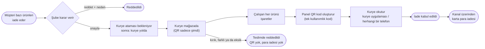

# 06 – Tıklanabilir Prototipten Çıkan Kararlar

🇬🇧 [English](06-prototype-decisions.md) · 🇩🇪 [Deutsch](06-prototype-decisions.de.md) · 🇹🇷 **Türkçe**

Tıklanabilir prototip [prototype/panel.html](../../prototype/panel.html) (sürüm **v1.0.1**, örnek veriler), backend yazılmadan önce ekranları gerçek kullanıcılarla denemek için kullanıldı. Denerken birçok yeni iş kuralı ortaya çıktı. Bu belge hepsini tek yerde topluyor: **ne** karar verildi, **neden**, hangi kullanıcı hikâyelerini ve ekranları etkiliyor ve veritabanı için ne anlama geliyor. Yeni hikâyeler [03 – Kullanıcı Hikâyeleri](03-user-stories.tr.md) içinde US-40 – US-54, yeni ekranlar [05 – Ekranlar](05-screens.tr.md) içinde S-19 – S-24.

## 1. Genel bakış
| ID | Karar | Hikâyeler | Ekran |
|---|---|---|---|
| PD-01 | Şube adı **Lindenkorb Süpermarket · Berlin-Spandau**, demo hesaplarıyla giriş (4 çalışan) | US-01 | S-01 |
| PD-02 | Bir ürün **her kanal için ayrı ayrı satışa açılıp kapatılabilir** | US-40 | S-19 |
| PD-03 | **Yeni sipariş uyarısı:** her kanalın kendi sesi + kanal renginde 3 saniyelik üst bildirim | US-41 | tümü |
| PD-04 | Kabul edilmeyen siparişler için **bekleme seviyeleri:** yeni · bekliyor · gecikmede · çok gecikmiş | US-42 | S-04 |
| PD-05 | Siparişler beklerken her 2 dakikada bir **WhatsApp hatırlatması** | US-43 | S-20 |
| PD-06 | **Tutar koruması:** satır başına ağırlık ±%10, ürün tutarı en fazla +%15 | US-44 | S-05 |
| PD-07 | Eksik ürün / büyük düşüş sadece **kayda geçen müşteri onayıyla** | US-45 | S-05 |
| PD-08 | **Kurye kapasitesi 20 litre;** daha büyük siparişler otomatik ve eşit bölünür | US-46 | S-04, S-05 |
| PD-09 | **Yeni iptal kuralları:** önce neden seçilir; "Şube çok yoğun" aramadan | US-12 | S-05 |
| PD-10 | **Kısmi iade:** siparişin sadece bazı ürünleri, fotoğraf ve adetle | US-47 | S-08 |
| PD-11 | Kuryenin okuttuğu **QR kod ile iade teslim alma** | US-48 | S-21, S-22 |
| PD-12 | İade kabul edildiği anda müşterinin kartına **para iadesi** | US-49 | S-21 |
| PD-13 | İade ve iptal nedenleri her zaman görünür ve süzülebilir | US-50 | S-04, S-08 |
| PD-14 | Üç kriterde **müşteri değerlendirmesi:** servis, lezzet, teslimat | US-51 | S-03, S-23 |
| PD-15 | Satış raporu **günlük, haftalık, aylık, yıllık;** günlük görünümde ayrıntı listeleri | US-52 | S-12 |
| PD-16 | **Gündüz ve gece modu** | US-53 | tümü |
| PD-17 | İlk ziyarette 6 adımlık **demo turu** (cihazda hatırlanır), profil menüsünden yeniden açılabilir | – | tümü |
| PD-18 | **Kanal bazında süreli indirimler:** tüm, kategori, seçili ya da SKT'si yaklaşan ürünler; yüzde ya da tutar; dakikadan haftaya | US-54 | S-24 |

## 2. Tutar koruması (PD-06, PD-07)
**Sorun:** Bir çalışan 1 kg muz yerine 15 kg yazar – müşterinin kartından çok fazla para çekilir.

| Kural | Sınır | Ne olur |
|---|---|---|
| Tartılı satır | sipariş edilen ağırlık **±%10** (1 kg → 0,90 – 1,10 kg) | Kutu kırmızı olur, *Hazır* engellenir |
| Ürün tutarı (poşet ücreti hariç) | sipariş tutarının en fazla **+%15**'i | **Kesin sınır** – müşteri onayıyla da aşılamaz |
| Ürün tutarı düşük / ürün eksik | **−%15**'ten fazla düşüş ya da eksik satır | Ancak müşteri en az **1 kez aranıp** (kayıtlı arama) *"müşteri bilgilendirildi ve onayladı"* kutusu işaretlenirse; saat kaydedilir |

| Sipariş | En fazla (+%15) | Şunun altında onay gerekir (−%15) |
|---|---|---|
| 7,00 € | 8,05 € | 5,95 € |
| 20,00 € | 23,00 € | 17,00 € |
| 100,00 € | 115,00 € | 85,00 € |

**Neden +%15:** Teslimat platformları sipariş tutarı + bir tampon kadar parayı kartta ayırır (ön provizyon) ve son tutarı sonra çeker. Bizim sınırımız bu tamponla aynı; yani banka ve panel aynı kuralı kullanır.

## 3. Kurye kapasitesi ve bölünen siparişler (PD-08)
- Her ürünün **litre cinsinden hacmi** vardır (ambalaj dahil; hacimli ürünler daha çok sayılır, ör. tuvalet kâğıdı 9 L, cips 1,8 L).
- Bir kurye en fazla **20 L** taşır. 20 L'yi geçen sipariş otomatik bölünür:
  1. Kısım sayısı = toplam ÷ 20, yukarı yuvarlanır (36,6 L → 2 kısım).
  2. Bir ürün satırı **tek kısımda bütün kalır** (aynı ürün iki kısımda olmaz); sadece tek başına 20 L'yi geçen satır bölünür.
  3. Satırlar büyükten küçüğe, o an en az yük taşıyan kısma verilir → litreler olabildiğince eşit paylaşılır.
- Her kısım sipariş numarasını korur ve yanında *"(otomatik bölünmüş sipariş · n. kısım)"* yazar; ayrı satırda bekler, ayrı toplanır ve ayrı kuryeyle gider. Sayımlarda ve raporlarda bölünmüş sipariş **tek** siparişdir.

| Örnek | 1. kısım | 2. kısım |
|---|---|---|
| HT-10485 (36,6 L) | 3× 5 L su, 2× cips → 19,2 L | tuvalet kâğıdı, 4× kola, 4× süt → 17,4 L |
| GK-55124 (32,3 L) | 2× 5 L su, 4× süt, 2× domates → 17,0 L | tuvalet kâğıdı, 6× portakal suyu → 15,3 L |

## 4. Şubenin iptal etmesi (PD-09)
[04 – Sipariş Süreci §9](04-order-process.tr.md) içindeki tablonun yerine geçer.

| Neden (şube seçer) | Ne zaman seçilebilir | Mağaza puanı |
|---|---|---|
| Şube çok yoğun | hemen, **arama gerekmez** | **Etkiler** |
| Müşteriye ulaşılamadı | **2 kayıtlı aramadan** sonra (2 dakika arayla) | Etkilemez |
| Ürün stokta yok | **2 kayıtlı aramadan** sonra | **Etkiler** |
| Müşteri iptal etti / adres hatalı | sadece **kanaldan** gelir, şubeye sunulmaz | Etkilemez |

- Hiçbir neden önceden seçili gelmez; neden seçilene kadar *İptal et* düğmesi gri kalır, seçilince kırmızı olur.

## 5. Sipariş uyarıları ve WhatsApp hatırlatmaları (PD-03 – PD-05)
| Bekleme süresi | Etiket | Ne olur |
|---|---|---|
| gelince | Yeni | Ses (HTGO: zil, GK: marimba) + 3 saniye üst bildirim *"Yeni sipariş var · kanal"* |
| 2 dk'dan itibaren | Kabul bekliyor | WhatsApp: *"… 2 dakikadır kabul etmenizi bekleyen sipariş var"* |
| 6 dk'dan itibaren | Gecikmede | Her 2 dakikada WhatsApp: *"… sipariş gecikmede"* |
| 12 dk'dan itibaren | Çok gecikmiş | WhatsApp: *"… sipariş çok gecikmiş – lütfen hemen kabul edin"* |

- Sunucu her 2 dakikada bir kontrol eder; mesaj **en eski** bekleyen siparişe göre yazılır. Alıcılar: vardiyadaki, telefonu kayıtlı ve WhatsApp'ı açık personel.
- Gerçek uygulamada ses mobil uygulamanın **anlık bildirimi** (push) olarak gelir (telefon kilitliyken de); WhatsApp mesajları onaylı bir şablonla **WhatsApp Business API** üzerinden gider.

## 6. İadeler, QR ile teslim alma ve para iadesi (PD-10 – PD-13)

- Bir iade sadece geri gönderilen ürünleri fotoğraf ve adetle gösterir; iade tutarı = iade adedi × sipariş satırındaki fiyat (US-14).
- İade nedenleri: hasar görmüş, bozulmuş, son kullanma tarihi geçmiş, yanlış ürün, eksik ürün, soğuk zincir bozulmuş – artı müşterinin kendi notu. Nedene basınca sipariş, iade edilen satırlar işaretli olarak açılır; neden düğmeleri listeyi süzer.

## 7. Diğer kararlar
- **Satışa aç / kapat (PD-02):** her ürün için iki anahtar (HTGO, GK). Kapalı ürünü o kanalın müşterileri görmez; stok 0 ise otomatik kapanır.
- **Değerlendirmeler (PD-14):** HTGO 4,9 (2304 yorum), GK 4,7 (2026 yorum); her değerlendirmede servis, lezzet ve teslimat için 1 – 5 yıldız vardır. Panel sadece gösterir.
- **Raporlar (PD-15):** Bugünün rakamları doğrudan sipariş satırlarından sayılır; bu yüzden ana sayfa, *Tümü* sekmesi ve günlük rapor hep aynıdır. Günlük görünümde *Sipariş, Ciro, İptaller, İadeler* kutuları rakamın arkasındaki listeyi açar. Pazar günleri kapalı (Almanya).
- **Gündüz / gece modu (PD-16):** profilin yanında güneş / ay düğmesi; seçim cihazda hatırlanır.
- **İndirimler (PD-18):** bir indirim **tek bir kanala** aittir ve belirli bir süre (dakika, saat, gün ya da hafta) geçerlidir. Son tüketim tarihine **3 gün veya daha az** kalan ürünler otomatik listelenir; böylece atılmak yerine satılır. Kurallar: en fazla **%70**, fiyat **0,01 €**'nun altına inmez, bir ürüne aynı anda tek indirim (en yüksek olan geçerli). Yeni sipariş indirimli fiyatı saklar (US-14); indirimi durdurmak verilmiş siparişleri değiştirmez. Örnek: tam yağlı süt 1,29 € − %30 = 0,90 €.

## 8. Yasal notlar
- **Marka:** Entegrasyonu anlatmak için "WhatsApp" adı kullanılabilir; logo kullanılmaz ve ortaklık izlenimi verilmez.
- **DSGVO (KVKK benzeri):** Çalışanın telefon numarası kişisel veridir – WhatsApp hatırlatmaları için çalışanın izni (kişi başına anahtar) ve gizlilik metninde not gerekir (veriler Meta'ya, ABD'ye gider). Numaralar gizlenmiş gösterilir.
- **Çalışan temsilciliği (Betriebsrat):** "Kim ne kadar hızlı kabul etti" bilgisi çalışanları izlemek için kullanılabilir; bu yüzden kişi bazlı değerlendirmeden önce temsilciliğin onayı gerekir.
- Hatırlatmalar sadece vardiyadaki personele gider (çalışma süresi yasası).

## 9. Veritabanına etkisi (V2 migration ile yapıldı)
nSon sütunlar (ör. **şube** ve kanal bazında satış durumu, şube stoğunda son tüketim tarihi) [01 – ER modeli §6](../database/01-er-model.tr.md) içinde.
| Değişiklik | Neden |
|---|---|
| `products.volume_l` | kurye kapasitesi (PD-08) |
| yeni `product_channel_status (product_id, channel_id, on_sale)` | kanal başına satışa aç / kapat (PD-02) |
| `orders.split_parent_id`, `orders.split_part` | bölünen siparişler (PD-08) |
| `orders.customer_ok_at` | eksik ürün / büyük düşüş için onay (PD-07) |
| `orders_cancel_guard` trigger'ı: *şube çok yoğun* aramasız; *adres hatalı* sadece kanaldan | yeni iptal kuralları (PD-09) |
| `returns.reason_code` | iade nedenleri (PD-13) |
| yeni `return_handovers (return_id, token, status, qr_created_at, received_at, courier)` ve para iadesi zamanı | QR ile teslim alma ve para iadesi (PD-11, PD-12) |
| `users.phone`, `users.whatsapp_opt_in` + yeni `notification_log` | WhatsApp hatırlatmaları ve izin (PD-05) |
| yeni `reviews (order_id, service, taste, delivery, comment)` | değerlendirmeler (PD-14) |
| yeni `discounts (id, channel_id, scope, category, type, value, starts_at, ends_at, stopped_at)` + `discount_products` | süreli indirimler (PD-18) |

## 10. Açık sorular
- 20 L sınırı kuryenin aracına göre mi değişmeli (bisiklet / araba)?
- Süpermarket için doğru kriter "lezzet" mi, yoksa "ürün kalitesi" mi?
- Bir ürünü satışa kim kapatabilir: her çalışan mı, sadece şube müdürü mü?
