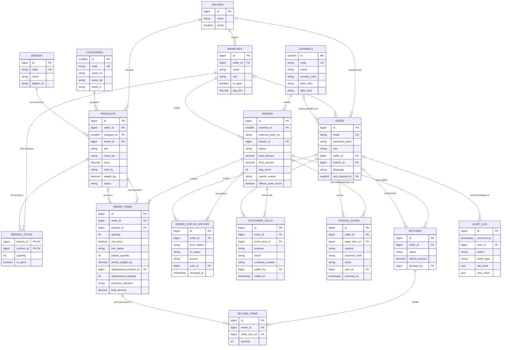

# 01 – Datenmodell (ER-Modell)

🇬🇧 [English](01-er-model.md) · 🇩🇪 **Deutsch** · 🇹🇷 [Türkçe](01-er-model.tr.md)

Dieses Dokument beschreibt, wie VetisPilot seine Daten in PostgreSQL speichert. Es übersetzt die Analyse ([docs/analysis](../analysis/01-scope.de.md)) in Tabellen. Die ausführbare Fassung ist [V1__initial_schema.sql](../../backend/src/main/resources/db/migration/V1__initial_schema.sql) – eine Flyway-Migration, die das Backend beim Start ausführt.

## 1. Konventionen
| Thema | Regel |
|---|---|
| Namen | Englisch, `snake_case`, Tabellennamen im Plural (`orders`, `order_items`) |
| Primärschlüssel | `id BIGINT GENERATED ALWAYS AS IDENTITY` – die Datenbank nummeriert neue Zeilen selbst |
| Feste Wertelisten | `VARCHAR` + `CHECK` (z. B. Bestellstatus), gut lesbar und leicht erweiterbar |
| Geld | `NUMERIC(10,2)` in EUR – exakt, niemals `FLOAT` |
| Zeit | `TIMESTAMPTZ` – gespeichert in UTC, angezeigt in Europe/Berlin |
| Übersetzungen | Drei Spalten pro Text: `name_en`, `name_de`, `name_tr` |
| Sprache im Code | Tabellen, Spalten und SQL-Kommentare sind auf Englisch; die Dokumentation auf EN / DE / TR |

## 2. ER-Diagramm
Linien zeigen Beziehungen. `||` = genau eins, `o|` = null oder eins, `o{` = null oder viele, `|{` = eins oder viele.



## 3. Tabellen
| Tabelle | Was eine Zeile ist | Wichtige Regeln | Stories |
|---|---|---|---|
| `sellers` | Ein Geschäft (Händler) | – | US-24 |
| `branches` | Eine Filiale eines Händlers | `is_open = false` → Kanäle erhalten eine Ablehnung; `bag_fee` pro Tüte (Standard 0,25 €) | US-21, US-33 |
| `users` | Ein Anmeldekonto | E-Mail eindeutig; gespeichert wird nur ein BCrypt-Hash; die Rolle bestimmt, ob `seller_id` / `branch_id` gesetzt sein müssen (Check `users_role_scope`); `last_channel_id` merkt sich den zuletzt gewählten Kanal | US-01 – US-04, US-22, US-23, US-39 |
| `channels` | Ein Lieferkanal (HTGO, GK) | Das HMAC-Geheimnis liegt **nicht** in der Datenbank, sondern in `.env`; die Farben gestalten das Panel nach der Kanalwahl | US-05, US-39 |
| `categories` | Eine Produktkategorie, Namen auf EN / DE / TR | `code` = mittlerer Teil der SKU (`VP-DRY-001`) | US-17 |
| `brands` | Eine (fiktive) Marke | Markennamen werden nie übersetzt | – |
| `products` | Ein Produkt im Katalog eines Händlers | Preis > 0; `sku` eindeutig pro Händler; nach einer Bestellung nie gelöscht, nur `ARCHIVED`; `sold_by` = PIECE oder WEIGHT, Gewichtsartikel haben ein `weight_kg` (Check `products_weight`) | US-13 – US-15, US-32 |
| `branch_stock` | Bestand eines Produkts in einer Filiale | Zusammengesetzter Schlüssel (Filiale, Produkt); Menge 0 ⇒ nicht vorrätig (Check `stock_zero_means_out`) | US-16 |
| `orders` | Eine Bestellung von einem Kanal | Eindeutig pro (Kanal, Bestellnummer des Kanals); eine stornierte Bestellung hat immer *wer* und *warum* (Check `orders_cancel_info`); `total_amount` = wie bestellt, `final_amount` = nach der Kommissionierung, ab *Bereit* zusammen mit den Tüten gesetzt (Check `orders_final_amount`); `affects_store_score` wird bei der Stornierung von einem Trigger gesetzt (Regel R6) | US-05 – US-12, US-33, US-36 |
| `order_items` | Eine Produktzeile einer Bestellung | `unit_price` ist eine Kopie des Preises zum Bestellzeitpunkt; Ergebnis der Kommissionierung: `line_status` OPEN / PICKED / REPLACED / REMOVED, echtes Gewicht, Ersatzprodukt nur mit Zustimmung des Kunden (Check `items_replacement`), entfernte Zeilen kosten 0 €; `picked_quantity` wird pro Zeile gezählt und muss zu `line_status` passen (Check `items_quantity_status`); eine fehlende Menge braucht die Entscheidung des Kunden | US-08, US-14, US-31, US-32, US-34 |
| `order_status_history` | Ein Statuswechsel | `source` = USER / CHANNEL / SYSTEM; `user_id` nur, wenn ein Benutzer ihn ausgelöst hat | US-08, G2 |
| `customer_calls` | Ein Anrufversuch beim Kunden | Ergebnis NO_ANSWER oder REACHED; bei REACHED ist die Antwort des Kunden Pflicht (Check `calls_answer_when_reached`). Der Nachweis für Entfernungen und Stornierungen | US-35 |
| `picking_scans` | Ein Barcode-Scan oder eine manuelle Zählung beim Kommissionieren | `method` SCAN oder MANUAL; ein MANUAL-Eintrag zählt immer eine Zeile; Fehlscans (nicht in der Bestellung, unbekannt) werden ebenfalls gespeichert | US-37, US-38 |
| `returns` | Eine Retourenanfrage | Eine Ablehnung braucht einen Grund | US-18, US-19 |
| `return_items` | Eine retournierte Produktzeile | Verweist auf die ursprüngliche Bestellzeile | US-18 |
| `audit_log` | Eine protokollierte Änderung | Zeilen können nur eingefügt werden; `UPDATE` / `DELETE` blockiert ein Trigger | US-25, R4 |

## 4. Designentscheidungen
| # | Entscheidung | Warum | Quelle |
|---|---|---|---|
| D1 | Der Bestand liegt in einer eigenen Tabelle `branch_stock` (eine Zeile pro Filiale und Produkt) | Der Katalog gehört dem Händler, der Bestand ist aber je Filiale verschieden | A2, US-16 |
| D2 | `order_items.unit_price` speichert eine Kopie des Preises | Ändert sich der Preis morgen, dürfen sich heutige Bestellungen und Berichte nicht ändern | US-14 |
| D3 | `UNIQUE (channel_id, external_order_no)` auf `orders` | Ein Kanal kann dieselbe Bestellung nach einem Netzwerkfehler zweimal senden – die Datenbank selbst lehnt das Duplikat ab (*Idempotenz*) | US-05, E2 |
| D4 | Statuswechsel werden als Ereignisprotokoll gespeichert (`order_status_history`) | Liefert den Statusverlauf auf dem Bildschirm **und** alle gemessenen Zeiten (Reaktion, Vorbereitung, Lieferung) ohne zusätzliche Spalten | US-08, G2 |
| D5 | Nichts Wichtiges wird gelöscht: Produkte werden archiviert, Bestellungen storniert | Alte Bestellungen, Berichte und der Audit-Trail bleiben korrekt | US-15, R3 |
| D6 | Übersetzungen als Spalten `_en / _de / _tr` | Genau drei feste Sprachen – einfache Abfragen ohne zusätzliche Joins. Eine vierte Sprache bräuchte neue Spalten (bewusster Kompromiss) | A7, US-03 |
| D7 | Die Rollenregel wird von der Datenbank erzwungen (Check-Constraint) | Ein Admin mit Filiale oder ein Mitarbeiter ohne Filiale ist unmöglich – selbst nach einem Fehler im Code | 02 – Rollen |
| D8 | `audit_log` ist nur erweiterbar (Trigger) | Ein Audit-Trail, den man bearbeiten kann, ist wertlos | R4, US-25 |
| D9 | Keine Geheimnisse in der Datenbank: Passwörter nur als BCrypt-Hash, Kanalschlüssel in `.env` | Eine gestohlene Datenbankkopie verrät weder Passwörter noch Schlüssel | Sicherheit |
| D10 | Geld als `NUMERIC`, Zeit als `TIMESTAMPTZ` | `FLOAT` verursacht Rundungsfehler (0,1 + 0,2 ≠ 0,3); Zeitzonen und Sommerzeit werden korrekt behandelt | Berichte |
| D11 | Zwei Beträge pro Bestellung: `total_amount` (wie bestellt) und `final_amount` (nach der Kommissionierung) | Der Kanal belastet den Endbetrag; Berichte zeigen, wie stark Ersatz, Gewichte und Tüten den Umsatz verändert haben | A8 – A10, US-31 – US-33 |
| D12 | Ein Ersatz bleibt in der ursprünglichen Zeile (`replacement_product_id`) statt in einer neuen Zeile | Es ist immer klar, was der Kunde bestellt und was er bekommen hat – die Grundlage für einen Bericht zur „Ersatzquote“ | US-31 |
| D13 | Jeder Anruf beim Kunden ist eine Zeile in `customer_calls` | Das Anrufprotokoll belegt, warum ein Artikel entfernt oder eine Bestellung storniert wurde; ohne es kann die Filiale nicht stornieren | A11, US-35, R6 |
| D14 | Der Stornoschutz ist ein Datenbank-Trigger, der auch `affects_store_score` setzt | Die Filiale kann eine schlechte Bewertung nicht umgehen, indem sie auf dem Bildschirm einen anderen Grund wählt – die Datenbank entscheidet anhand der protokollierten Anrufe | A11, US-36 |
| D15 | Jeder Scan und jede manuelle Zählung ist eine Zeile in `picking_scans` | Manuelle Zählungen sind erlaubt, aber nie unsichtbar; der Bericht zur Kommissionierqualität zählt sie pro Filiale und Mitarbeiter | A13, US-37, US-38 |
| D16 | Kanalfarben liegen in der Tabelle `channels`, die letzte Wahl in `users.last_channel_id` | Ein neuer Kanal oder neue Farben brauchen keine Codeänderung; das Panel öffnet sich im zuletzt genutzten Kanal | US-39 |

Regeln, die die Datenbank allein nicht prüfen kann (z. B. dass die Filiale eines Mitarbeiters zum selben Händler gehört oder welche Statuswechsel erlaubt sind), setzt das Backend durch; siehe [04 – Bestellprozess](../analysis/04-order-process.de.md).

## 5. Datenbank lokal starten
```powershell
copy .env.example .env      # einmalig; danach in .env ein eigenes Passwort setzen
docker compose up -d        # startet PostgreSQL (leere Datenbank)
# danach das Backend starten (IntelliJ oder cd backend && ./mvnw spring-boot:run): Flyway legt alle Tabellen an
docker compose down -v      # löscht die Datenbank vollständig (für einen Neustart)
```

## 6. Geplante Änderungen aus dem Prototyp
Der Test des klickbaren Prototyps (v1.0.1) hat neue Regeln gebracht, die Schemaänderungen brauchen: Produktvolumen, Verkaufsstatus pro Kanal, geteilte Bestellungen, Zeitpunkt der Kundenzustimmung, neue Stornoregeln im Trigger, Retourengründe, QR-Übergabe und Erstattung, WhatsApp-Einwilligung, Bewertungen und zeitlich begrenzte Rabatte. Sie stehen in [06 – Prototyp-Entscheidungen §9](../analysis/06-prototype-decisions.de.md) und kommen als neue Flyway-Migration (`V2__…`) – `V1` wird nach dem Ausführen nie mehr geändert.
