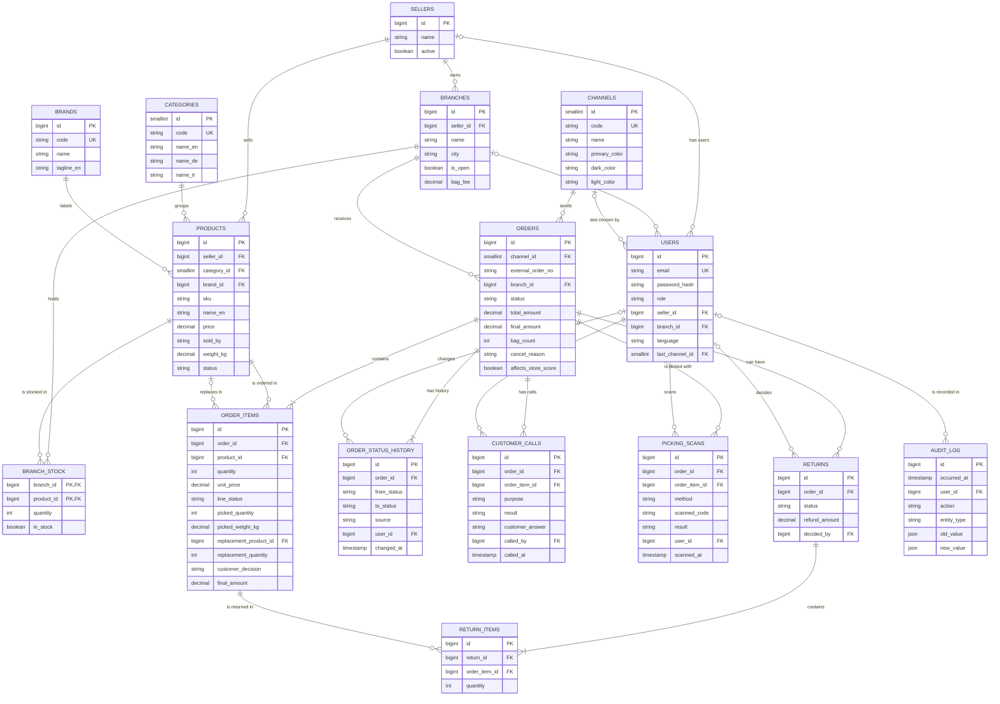

# 01 – Data Model (ER Model)

🇬🇧 **English** · 🇩🇪 [Deutsch](01-er-model.de.md) · 🇹🇷 [Türkçe](01-er-model.tr.md)

This document describes how VetisPilot stores its data in PostgreSQL. It turns the analysis ([docs/analysis](../analysis/01-scope.md)) into tables. The executable version is [V1__initial_schema.sql](../../backend/src/main/resources/db/migration/V1__initial_schema.sql) – a Flyway migration that the backend runs on start.

## 1. Conventions
| Topic | Rule |
|---|---|
| Names | English, `snake_case`, table names in plural (`orders`, `order_items`) |
| Primary key | `id BIGINT GENERATED ALWAYS AS IDENTITY` – the database numbers new rows itself |
| Fixed value lists | `VARCHAR` + `CHECK` (e.g. order status), easy to read and to extend |
| Money | `NUMERIC(10,2)` in EUR – exact, never `FLOAT` |
| Time | `TIMESTAMPTZ` – stored in UTC, shown in Europe/Berlin |
| Translations | Three columns per text: `name_en`, `name_de`, `name_tr` |
| Code language | Tables, columns and SQL comments are in English; the documentation is in EN / DE / TR |

## 2. ER diagram
Lines show relationships. `||` = exactly one, `o|` = zero or one, `o{` = zero or many, `|{` = one or many.



## 3. Tables
| Table | What one row is | Important rules | Stories |
|---|---|---|---|
| `sellers` | One business (seller) | – | US-24 |
| `branches` | One branch of a seller | `is_open = false` → channels get a rejection; `bag_fee` per bag (default €0.25) | US-21, US-33 |
| `users` | One login account | Email unique; only a BCrypt hash is stored; role decides which of `seller_id` / `branch_id` must be set (check `users_role_scope`); `last_channel_id` remembers the last chosen channel | US-01 – US-04, US-22, US-23, US-39 |
| `channels` | One delivery channel (HTGO, GK) | The HMAC secret is **not** stored in the database but in `.env`; the colors theme the panel after the channel choice | US-05, US-39 |
| `categories` | One product category, names in EN / DE / TR | `code` = middle part of the SKU (`VP-DRY-001`) | US-17 |
| `brands` | One (fictional) brand | Brand names are never translated | – |
| `products` | One product of a seller's catalog | Price > 0; `sku` unique per seller; never deleted once ordered, only `ARCHIVED`; `sold_by` = PIECE or WEIGHT, weight products have a `weight_kg` (check `products_weight`) | US-13 – US-15, US-32 |
| `branch_stock` | Stock of one product in one branch | Composite key (branch, product); quantity 0 ⇒ out of stock (check `stock_zero_means_out`) | US-16 |
| `orders` | One order from a channel | Unique per (channel, channel order number); a cancelled order always has *who* and *why* (check `orders_cancel_info`); `total_amount` = as ordered, `final_amount` = after picking, set from *Ready* on together with the bags (check `orders_final_amount`); `affects_store_score` is set by a trigger when the order is cancelled (rule R6) | US-05 – US-12, US-33, US-36 |
| `order_items` | One product line in an order | `unit_price` is a copy of the price at order time; picking result: `line_status` OPEN / PICKED / REPLACED / REMOVED, real weight, replacement product only with the customer's approval (check `items_replacement`), removed lines cost €0; `picked_quantity` is counted per line and must match `line_status` (check `items_quantity_status`); a missing part needs the customer's decision | US-08, US-14, US-31, US-32, US-34 |
| `order_status_history` | One status change | `source` = USER / CHANNEL / SYSTEM; `user_id` only when a user did it | US-08, G2 |
| `customer_calls` | One call attempt to the customer | Result NO_ANSWER or REACHED; when reached, the customer's answer is required (check `calls_answer_when_reached`). The evidence for removals and cancellations | US-35 |
| `picking_scans` | One barcode scan or one manual count while picking | `method` SCAN or MANUAL; a MANUAL entry always counts one line; wrong scans (not in the order, unknown) are saved too | US-37, US-38 |
| `returns` | One return request | Rejection needs a reason | US-18, US-19 |
| `return_items` | One returned product line | Points to the original order line | US-18 |
| `audit_log` | One recorded change | Rows can only be inserted; `UPDATE` / `DELETE` are blocked by a trigger | US-25, R4 |

## 4. Design decisions
| # | Decision | Why | Source |
|---|---|---|---|
| D1 | Stock lives in its own table `branch_stock` (one row per branch and product) | The catalog belongs to the seller, but stock differs per branch | A2, US-16 |
| D2 | `order_items.unit_price` stores a copy of the price | If the price changes tomorrow, today's orders and reports must not change | US-14 |
| D3 | `UNIQUE (channel_id, external_order_no)` on `orders` | A channel may send the same order twice after a network error – the database itself refuses the duplicate (*idempotency*) | US-05, E2 |
| D4 | Status changes are stored as an event log (`order_status_history`) | Gives the status history on screen **and** all measured times (reaction, preparation, delivery) without extra columns | US-08, G2 |
| D5 | Nothing important is deleted: products are archived, orders are cancelled | Old orders, reports and the audit trail stay correct | US-15, R3 |
| D6 | Translations as `_en / _de / _tr` columns | Exactly three fixed languages – simple queries, no extra joins. A fourth language would need new columns (accepted trade-off) | A7, US-03 |
| D7 | The role rule is enforced by the database (check constraint) | An admin with a branch or an employee without a branch is impossible, even after a bug in the code | 02 – Roles |
| D8 | `audit_log` is append-only (trigger) | An audit trail that can be edited is worthless | R4, US-25 |
| D9 | No secrets in the database: passwords only as BCrypt hash, channel keys in `.env` | A leaked database copy does not reveal passwords or keys | Security |
| D10 | Money as `NUMERIC`, time as `TIMESTAMPTZ` | `FLOAT` causes rounding errors (0.1 + 0.2 ≠ 0.3); time zones and daylight saving time are handled correctly | Reports |
| D11 | Two amounts per order: `total_amount` (as ordered) and `final_amount` (after picking) | The channel charges the final amount; reports can show how much replacements, weights and bags changed the revenue | A8 – A10, US-31 – US-33 |
| D12 | A replacement stays on the original line (`replacement_product_id`) instead of a new line | It is always clear what the customer ordered and what they received – the basis for a "replacement rate" report | US-31 |
| D13 | Every call to the customer is a row in `customer_calls` | The call log proves why an item was removed or an order cancelled; without it the branch cannot cancel | A11, US-35, R6 |
| D14 | The cancellation guard is a database trigger that also sets `affects_store_score` | The store cannot avoid a bad score by choosing another reason on the screen – the database decides from the logged calls | A11, US-36 |
| D15 | Every scan and every manual count is a row in `picking_scans` | Manual counts are allowed but never invisible; the picking quality report counts them per branch and employee | A13, US-37, US-38 |
| D16 | Channel colors live in the `channels` table, the last choice in `users.last_channel_id` | A new channel or new colors need no code change; the panel opens in the channel the user worked in last | US-39 |

Rules that the database cannot check alone (e.g. an employee's branch must belong to the same seller, or which status changes are allowed) are enforced in the backend; see [04 – Order Process](../analysis/04-order-process.md).

## 5. Run the database locally
```powershell
copy .env.example .env      # once; then set your own password in .env
docker compose up -d        # starts PostgreSQL (empty database)
# then start the backend (IntelliJ or mvn spring-boot:run): Flyway creates all tables
docker compose down -v      # deletes the database completely (for a fresh start)
```

## 6. Planned changes from the prototype
Testing the clickable prototype (v1.0.1) brought new rules that need schema changes: product volume, sale status per channel, split orders, customer approval time, new cancellation rules in the trigger, return reasons, QR handover and refund, WhatsApp consent and reviews. They are listed in [06 – Prototype decisions §9](../analysis/06-prototype-decisions.md) and will come as a new Flyway migration (`V2__…`) – `V1` is never changed after it has run.
