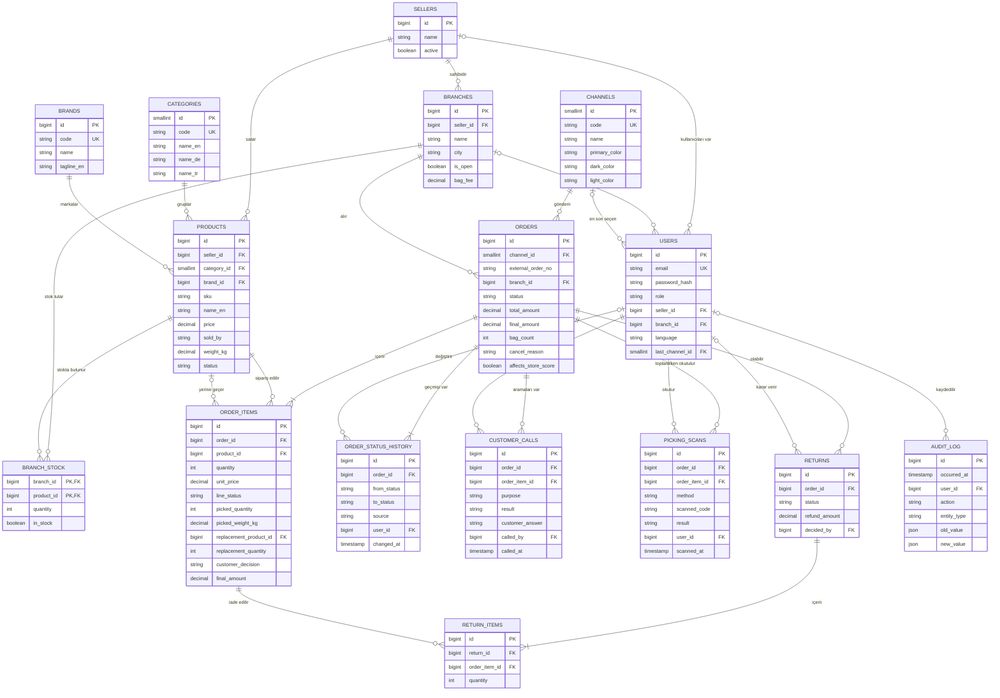

# 01 – Veri Modeli (ER Modeli)

🇬🇧 [English](01-er-model.md) · 🇩🇪 [Deutsch](01-er-model.de.md) · 🇹🇷 **Türkçe**

Bu belge, VetisPilot'un verilerini PostgreSQL'de nasıl sakladığını anlatır. Analizi ([docs/analysis](../analysis/01-scope.tr.md)) tablolara dönüştürür. Çalıştırılabilir hali [database/init/01_schema.sql](../../database/init/01_schema.sql) dosyasıdır.

## 1. Kurallar
| Konu | Kural |
|---|---|
| İsimler | İngilizce, `snake_case`, tablo adları çoğul (`orders`, `order_items`) |
| Birincil anahtar | `id BIGINT GENERATED ALWAYS AS IDENTITY` – yeni satırları veritabanı kendisi numaralar |
| Sabit değer listeleri | `VARCHAR` + `CHECK` (ör. sipariş durumu), okunması ve genişletmesi kolay |
| Para | EUR cinsinden `NUMERIC(10,2)` – kuruşu kuruşuna doğru, asla `FLOAT` değil |
| Zaman | `TIMESTAMPTZ` – UTC olarak saklanır, Europe/Berlin saatiyle gösterilir |
| Çeviriler | Her metin için üç sütun: `name_en`, `name_de`, `name_tr` |
| Kod dili | Tablolar, sütunlar ve SQL yorumları İngilizce; dokümantasyon EN / DE / TR |

## 2. ER diyagramı
Çizgiler ilişkileri gösterir. `||` = tam olarak bir, `o|` = sıfır ya da bir, `o{` = sıfır ya da çok, `|{` = bir ya da çok.



## 3. Tablolar
| Tablo | Bir satır neyi temsil eder | Önemli kurallar | Story'ler |
|---|---|---|---|
| `sellers` | Bir işletme (satıcı) | – | US-24 |
| `branches` | Bir satıcının bir şubesi | `is_open = false` → kanallar ret cevabı alır; poşet başına `bag_fee` (varsayılan €0,25) | US-21, US-33 |
| `users` | Bir giriş hesabı | E-posta benzersiz; sadece BCrypt hash'i saklanır; `seller_id` / `branch_id` alanlarından hangisinin dolu olacağını rol belirler (`users_role_scope` kontrolü); `last_channel_id` en son seçilen kanalı hatırlar | US-01 – US-04, US-22, US-23, US-39 |
| `channels` | Bir teslimat kanalı (HTGO, GK) | HMAC gizli anahtarı veritabanında **değil**, `.env` dosyasında durur; renkler kanal seçildikten sonra panelin temasını belirler | US-05, US-39 |
| `categories` | Bir ürün kategorisi, EN / DE / TR adlarıyla | `code` = SKU'nun ortadaki kısmı (`VP-DRY-001`) | US-17 |
| `brands` | Bir (kurgusal) marka | Marka isimleri asla çevrilmez | – |
| `products` | Satıcının kataloğundaki bir ürün | Fiyat > 0; `sku` satıcı başına benzersiz; sipariş edildiyse asla silinmez, sadece `ARCHIVED` olur; `sold_by` = PIECE ya da WEIGHT, tartılı ürünlerin `weight_kg` değeri vardır (`products_weight` kontrolü) | US-13 – US-15, US-32 |
| `branch_stock` | Bir ürünün bir şubedeki stoğu | Bileşik anahtar (şube, ürün); miktar 0 ⇒ stokta yok (`stock_zero_means_out` kontrolü) | US-16 |
| `orders` | Bir kanaldan gelen bir sipariş | (kanal, kanalın sipariş no.) çifti benzersiz; iptal edilen siparişte *kim* ve *neden* her zaman dolu (`orders_cancel_info` kontrolü); `total_amount` = sipariş edildiği haliyle, `final_amount` = toplamadan sonra, *Hazır*'dan itibaren poşetlerle birlikte dolar (`orders_final_amount` kontrolü); `affects_store_score` sipariş iptal edilince bir trigger tarafından doldurulur (kural R6) | US-05 – US-12, US-33, US-36 |
| `order_items` | Siparişteki bir ürün satırı | `unit_price` sipariş anındaki fiyatın kopyasıdır; toplama sonucu: `line_status` OPEN / PICKED / REPLACED / REMOVED, gerçek ağırlık, sadece müşteri onayıyla yeni ürün (`items_replacement` kontrolü), çıkarılan satır €0; `picked_quantity` her satırda sayılır ve `line_status` ile uyumlu olmalıdır (`items_quantity_status` kontrolü); eksik kalan adet için müşterinin kararı gerekir | US-08, US-14, US-31, US-32, US-34 |
| `order_status_history` | Bir durum değişikliği | `source` = USER / CHANNEL / SYSTEM; `user_id` sadece değişikliği bir kullanıcı yaptıysa dolu | US-08, G2 |
| `customer_calls` | Müşteriye yapılan bir arama denemesi | Sonuç NO_ANSWER ya da REACHED; ulaşıldıysa müşterinin cevabı zorunludur (`calls_answer_when_reached` kontrolü). Ürün çıkarma ve iptallerin kanıtı | US-35 |
| `picking_scans` | Toplama sırasında bir barkod okutma ya da bir elle sayım | `method` SCAN ya da MANUAL; MANUAL kayıt her zaman bir satırı sayar; yanlış okutmalar (siparişte yok, bilinmiyor) da kaydedilir | US-37, US-38 |
| `returns` | Bir iade talebi | Ret için sebep zorunlu | US-18, US-19 |
| `return_items` | İade edilen bir ürün satırı | Orijinal sipariş satırını gösterir | US-18 |
| `audit_log` | Kayda geçen bir değişiklik | Satırlar sadece eklenebilir; `UPDATE` / `DELETE` bir trigger ile engellenir | US-25, R4 |

## 4. Tasarım kararları
| # | Karar | Neden | Kaynak |
|---|---|---|---|
| D1 | Stok ayrı bir tabloda, `branch_stock`'ta durur (her şube ve ürün için bir satır) | Katalog satıcıya ait, ama stok şubeden şubeye farklı | A2, US-16 |
| D2 | `order_items.unit_price` fiyatın bir kopyasını saklar | Fiyat yarın değişirse bugünün siparişleri ve raporları değişmemeli | US-14 |
| D3 | `orders` tablosunda `UNIQUE (channel_id, external_order_no)` | Kanal, ağ hatasından sonra aynı siparişi iki kez gönderebilir – kopyayı veritabanının kendisi reddeder (*idempotency*) | US-05, E2 |
| D4 | Durum değişiklikleri bir olay günlüğü olarak saklanır (`order_status_history`) | Ekrandaki durum geçmişini **ve** tüm ölçülen süreleri (tepki, hazırlama, teslimat) ek sütun olmadan verir | US-08, G2 |
| D5 | Önemli hiçbir şey silinmez: ürünler arşivlenir, siparişler iptal edilir | Eski siparişler, raporlar ve denetim izi doğru kalır | US-15, R3 |
| D6 | Çeviriler `_en / _de / _tr` sütunları olarak | Tam olarak üç sabit dil var – basit sorgular, ek join yok. Dördüncü bir dil yeni sütunlar gerektirir (bilinçli bir taviz) | A7, US-03 |
| D7 | Rol kuralını veritabanı uygular (check constraint) | Şubesi olan bir admin ya da şubesiz bir çalışan imkânsızdır – kodda bir hata olsa bile | 02 – Roller |
| D8 | `audit_log` sadece eklenebilir (trigger) | Düzenlenebilen bir denetim izi değersizdir | R4, US-25 |
| D9 | Veritabanında gizli bilgi yok: şifreler sadece BCrypt hash'i olarak, kanal anahtarları `.env`'de | Çalınan bir veritabanı kopyası ne şifreleri ne de anahtarları ele verir | Güvenlik |
| D10 | Para `NUMERIC`, zaman `TIMESTAMPTZ` | `FLOAT` yuvarlama hatası yapar (0,1 + 0,2 ≠ 0,3); saat dilimleri ve yaz saati doğru işlenir | Raporlar |
| D11 | Her siparişte iki tutar: `total_amount` (sipariş edilen) ve `final_amount` (toplamadan sonra) | Kanal son tutarı tahsil eder; raporlar ürün değişimi, ağırlık ve poşetlerin ciroyu ne kadar değiştirdiğini gösterebilir | A8 – A10, US-31 – US-33 |
| D12 | Ürün değişimi yeni bir satır yerine orijinal satırda tutulur (`replacement_product_id`) | Müşterinin ne sipariş ettiği ve ne aldığı her zaman bellidir – "ürün değişim oranı" raporunun temeli | US-31 |
| D13 | Müşteriyle yapılan her arama `customer_calls` tablosunda bir satırdır | Arama kaydı, bir ürünün neden çıkarıldığını ya da bir siparişin neden iptal edildiğini kanıtlar; o olmadan şube iptal edemez | A11, US-35, R6 |
| D14 | İptal koruması, `affects_store_score` alanını da dolduran bir veritabanı trigger'ıdır | Mağaza ekranda başka bir sebep seçerek kötü puandan kaçamaz – kararı kayıtlı aramalara bakarak veritabanı verir | A11, US-36 |
| D15 | Her okutma ve her elle sayım `picking_scans` tablosunda bir satırdır | Elle sayım serbesttir ama asla görünmez değildir; toplama kalitesi raporu bunları şube ve çalışan bazında sayar | A13, US-37, US-38 |
| D16 | Kanal renkleri `channels` tablosunda, son seçim `users.last_channel_id` alanında durur | Yeni bir kanal ya da yeni renkler kod değişikliği gerektirmez; panel kullanıcının en son çalıştığı kanalda açılır | US-39 |

Veritabanının tek başına kontrol edemediği kurallar (ör. bir çalışanın şubesinin aynı satıcıya ait olması ya da hangi durum geçişlerine izin verildiği) backend'de uygulanır; bkz. [04 – Sipariş Süreci](../analysis/04-order-process.tr.md).

## 5. Veritabanını yerelde çalıştırma
```powershell
copy .env.example .env      # bir kez; sonra .env içinde kendi şifreni belirle
docker compose up -d        # PostgreSQL'i başlatır, ilk açılışta tüm tabloları oluşturur
docker compose down -v      # veritabanını tamamen siler (sıfırdan başlamak için)
```
